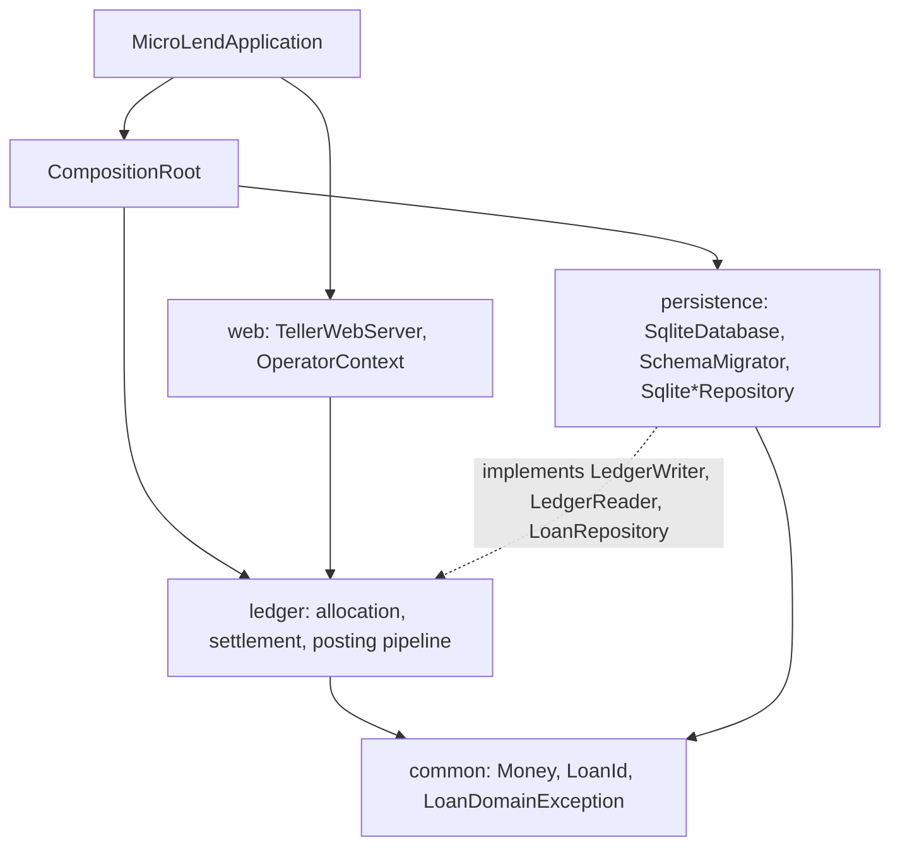
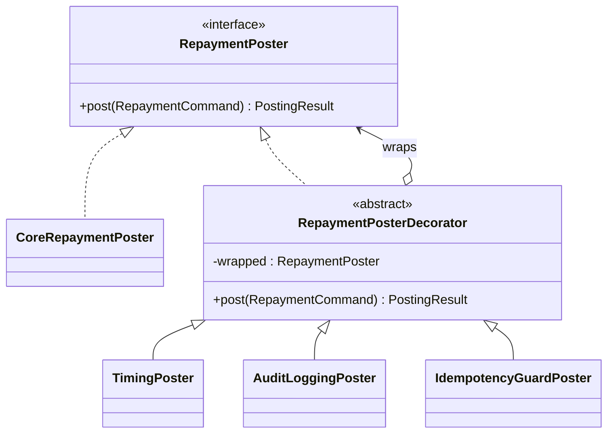

# Milestone 2 - SE423 Software Construction and Development

**Team Lead / Integrator (M2):** Muhammad Ibrahim
**Companion documents:** `docs/M1-SE423-Proposal-OOD-Pattern-Plan.md` (the design this build is measured against), `docs/M2-SE431-Verification-Baseline.md` (the quality evidence for the same build).
**Build described:** `feature/ledger-entry` at `701c161` (16 Nov 2026), pull request #8 into `develop`. Every number below comes from that commit's build output, its CI runs or its Git history. None is estimated.

## 0. Module status at writing

| Module / package | Owner | State on 16 Nov 2026 | Where |
|---|---|---|---|
| `common` | shared | Done: `Money`, `LoanId`, `LoanDomainException` and two subtypes | `main`, `develop` and PR #8 |
| `ledger` | Tughral Hussain | Done: allocation waterfall, settlement (partial, see 1.3), posting pipeline with Decorator chain, compensating reversals | PR #8 |
| `persistence` | Tughral Hussain | Done for the ledger's tables: schema v1 (7 tables), `SqliteLedgerRepository`, `SqliteLoanRepository` | PR #8 |
| `web` and composition root | Tughral Hussain | Done: local teller page on `127.0.0.1:8080`, `CompositionRoot` wiring both production chains | PR #8 |
| `origination` | Muhammad Ibrahim | Not started on any branch | - |
| `delinquency` (concurrent end-of-day engine) | Muhammad Ibrahim | Not started on any branch | - |
| `ledger.importing` (Adapter) | Muhammad Ibrahim | Not started on any branch | - |
| `products` (Factory Method) | Hassan Khalid | Only `DueDateCalculator` and its test, in PR #6 (targets `main`; CI failing) | PR #6 |
| `reporting` | Hassan Khalid | Not started on any branch | - |

Sections marked **"Owner to complete"** are placeholders for the parts not built at the time of writing. Each owner replaces them with their own evidence before submission.

## 1. Working core architecture

### 1.1 Built packages against the M1 component view

The M1 component view (M1 section 3.3) put `common` at the centre. Domain modules depend inward on it. `persistence` implements interfaces that the domain declares, and `web` sits on the outside. The built code follows that rule, and the rule is now enforced by the build, not just stated.



`src/test/java/pk/edu/giki/microlend/ArchitectureTest.java` (ArchUnit 1.3.0, queue item L-19) runs inside `.\gradlew.bat build` and in CI. It checks three rules:

| Rule | ArchUnit check | Source |
|---|---|---|
| No cycles between module packages | `slices().matching("pk.edu.giki.microlend.(*)..").should().beFreeOfCycles()` | Constraint C-03 |
| `common` and `ledger` never depend on `persistence` or `web` | `noClasses()...dependOnClassesThat().resideInAnyPackage(persistence, web)` | DIP, M1 section 4.5 |
| `common` depends on no module | `noClasses()` in `common` depend on `ledger`, `persistence` or `web` | M1 section 3.3 |

### 1.2 End-to-end path that runs today

`.\gradlew.bat run` starts `MicroLendApplication`. It builds `CompositionRoot.withPlaceholders(new SqliteDatabase("jdbc:sqlite:microlend.db"), operator)` and serves the teller form on the loopback address only (`InetAddress.getLoopbackAddress()`). The app is never deployed.

A teller posting then travels this path:

`TellerWebServer` (form) -> `AuditLoggingPoster` -> `TimingPoster` -> `CoreRepaymentPoster` -> `RepaymentAllocator` + `SettlementPolicy` -> `SqliteLedgerRepository.appendAll` (one transaction) -> `SqliteLoanRepository.save` (`BEGIN IMMEDIATE`)

Two inputs come from modules that are not built yet:
- the instalments owed (`products`, plus the accrued penalty from `delinquency`);
- the early-settlement rebate (`products`).

These enter through two ledger role interfaces, `InstalmentsDueSource` and `EarlySettlementRebate`. `withPlaceholders` fills both with lambdas that throw `ModuleNotAvailableException`, which names the owner. So the running app reports clearly which module is missing instead of failing obscurely. `CompositionRootTest` and `TellerWebServerTest` exercise the whole chain with test doubles for those two roles. The persistence path is exercised against a real SQLite file by `SqliteLedgerRepositoryTest`, `SqliteLoanRepositoryTest` and `PostingFaultInjectionTest`.

**Owner to complete (Muhammad Ibrahim, Hassan Khalid).** Replace the two placeholders in `CompositionRoot.withPlaceholders` with:
- an `InstalmentsDueSource` that maps `products.Instalment` and the accrued penalty to `ledger.InstalmentDue`;
- the per-product `EarlySettlementRebate`.

Then wire origination, the end-of-day engine and reporting into the root and the web page, and record the end-to-end demo here.

### 1.3 Deviations from the M1 design, with reasons

| Deviation | M1 said | Built | Why |
|---|---|---|---|
| Allocator input type | `RepaymentAllocator.allocate()` over `products.Instalment` | Takes `ledger.InstalmentDue` (record: sequence, due date, outstanding penalty, fees, interest, principal) | M1's `Instalment` holds only principal and interest. The allocator also needs what is still owed per tier, including the penalty accrued by `delinquency`. A ledger-owned input keeps `ledger` independent of `products`, so it compiles and tests now and needs no `ledger -> products` dependency. `products.Instalment` is mapped onto it through `InstalmentsDueSource` |
| BR-18 / BR-19 order | "penalty -> fees -> interest -> principal, oldest first" | Tier by tier: all penalties oldest first, then fees, then interest, then principal | The rule text allows two readings. The literal one was adopted on 14 Nov 2026 and is recorded under BR-19 in `docs/business-rules.md`, pending team confirmation. Only `RepaymentAllocator` and its test change if the team chooses otherwise |
| Debit leg of a repayment | Not specified | New `EntryType.PAYMENT_RECEIVED` debit balanced by one credit per tier | Without it a posting's lines cannot balance on their own (BR-23). The schema `CHECK` on `entry_type` lists it |
| Multi-line writes | `LedgerWriter.append(entry)` | Adds `LedgerWriter.appendAll(List<LedgerEntry>)`, all or nothing | A posting is 2 to 6 lines. Writing them one by one would leave a half-posted repayment if a write failed mid-way |
| Ledger write vs loan save | One transaction for read, allocate and write | Two transactions; if the loan save fails, `CoreRepaymentPoster` appends a reversal of every line it wrote (BR-24) | The two repositories open their own connections. The compensating reversal keeps the ledger balanced, which `PostingFaultInjectionTest` proves at 14 failure points. Merging them into one transaction is an open item for M3 |
| Settlement | `SettlementPolicy` covers BR-21 and BR-22 | BR-21 advance credit and payoff detection built; the BR-22 rebate is requested through `EarlySettlementRebate`; money above the payoff is refused | The rebate amount differs per product type, which is `products` knowledge. No rule says how an excess over the payoff is returned, so it is refused rather than invented |
| Duplicate-reference store | `UNIQUE (source_bank, bank_reference)` on `payment` | `PaymentReferences` role with `InMemoryPaymentReferences` | The guard and its role are in place. A durable store on the `payment` table is deferred until the CSV import (Ibrahim) writes payments |
| Package `persistence` | Implementations named, package implied | Explicit `pk.edu.giki.microlend.persistence` | It holds the SQLite code apart from the domain, so the ArchUnit rule in 1.1 can be stated |

## 2. Design patterns implemented

| Pattern | Kind | Owner | State |
|---|---|---|---|
| Decorator (`RepaymentPoster` pipeline) | Structural | Tughral Hussain | Implemented, integrated in both production chains, tested |
| Factory Method (`LoanProduct`) | Creational | Hassan Khalid | Not yet implemented |
| Adapter (bank statement adapters) | Structural | Muhammad Ibrahim | Not yet implemented |

### 2.1 Decorator: the repayment posting pipeline

**Problem it solves.** A posting sometimes also has to:
- write an audit line naming the operator (FR-31);
- record its elapsed time (the GQM measure);
- refuse a bank reference already posted (BR-25).

Which of these apply depends on the call path, and they combine (M1 section 5.3, table of call paths).

**Participants in the code:**

| GoF role | Class (`src/main/java/pk/edu/giki/microlend/ledger/`) | Queue item, green commit |
|---|---|---|
| Component | `RepaymentPoster` (interface, `post(RepaymentCommand)`) | L-08, `34a7bb7` |
| ConcreteComponent | `CoreRepaymentPoster`: reads the loan, allocates, settles, writes balanced lines, saves | L-08, `34a7bb7` |
| Decorator | `RepaymentPosterDecorator`: abstract; IS-A `RepaymentPoster` and HAS-A `RepaymentPoster` (`private final RepaymentPoster wrapped`); `post` forwards | L-09, `9f7b423` |
| ConcreteDecorator | `TimingPoster`: measures with an injected nanosecond ticker and reports to `PostingTimeRecorder`, for both success and refusal | L-09, `9f7b423` |
| ConcreteDecorator | `AuditLoggingPoster`: refuses a posting with no operator; journals posted and refused attempts to `AuditJournal` | L-10, `a43c681` |
| ConcreteDecorator | `IdempotencyGuardPoster`: claims (bank, reference) atomically through `PaymentReferences`, and releases the claim if the inner posting fails; cash passes through | L-11, `71d8b3f` |



**Integrated in running code.** `CompositionRoot` builds the two chains planned at M1 over one shared `CoreRepaymentPoster`:

```java
this.importPoster = new IdempotencyGuardPoster(
    new TimingPoster(core, System::nanoTime, (c, elapsed, ok) -> timings.add(elapsed)),
    new InMemoryPaymentReferences());
this.tellerPoster = new AuditLoggingPoster(
    new TimingPoster(core, System::nanoTime, (c, elapsed, ok) -> timings.add(elapsed)),
    operator, auditTrail::add, clock);
```

The teller page posts through `tellerPoster()`. The import chain waits for the CSV adapters (2.3). The guard is outermost so a duplicate is refused before anything is timed or written. `CompositionRootTest` checks both chains end to end against SQLite:
- the teller chain posts, audits the operator and times the posting;
- the import chain refuses a duplicate before it is timed, and writes no audit line.

**Benefit, shown by the tests.** Each behaviour is one class with one test class: `TimingPosterTest`, `AuditLoggingPosterTest` and `IdempotencyGuardPosterTest`. Each is tested against a stub inner poster, without a database. `CoreRepaymentPosterTest` tests the core with no decorator at all, which is the "unit tests" call path of M1 section 5.3. Adding a retry behaviour would be one new subclass and one line in the root.

**Rejected alternatives:**
- **Inheritance combinations.** Three optional behaviours would need eight subclasses, and the combination could not be chosen per call path.
- **Proxy.** Proxy controls access to one subject. The problem here is stacking several responsibilities in different combinations, which is the Decorator's intent (M1 section 5.3).

### 2.2 Factory Method: `LoanProduct` as Creator (planned at M1)

M1 design (section 5.1):
- **Creator:** `LoanProduct` holds the stable `generateSchedule()` workflow and declares `protected abstract InterestCalculator createInterestCalculator()`.
- **ConcreteCreators:** `FlatRateProduct`, `ReducingBalanceProduct` and `BulletProduct` each override that method.
- **Products:** `InterestCalculator` and its three concrete calculators.
- **Rejected:** a Simple Factory `create(type)` switch, which is not the GoF pattern, as well as Abstract Factory and Singleton.

**Status at writing (16 Nov 2026): not yet implemented. Owner to complete this subsection (Hassan Khalid).** It should give:
- the classes and their commit hashes;
- a class diagram;
- the test showing the workflow never names a concrete calculator;
- the shared `InterestCalculator` contract test (LSP evidence, M1 section 4.3);
- how `products.Instalment` is mapped to `ledger.InstalmentDue` (see 1.3).

### 2.3 Adapter: bank statement adapters (planned at M1)

M1 design (section 5.2):
- **Target:** `RepaymentSource`.
- **Adaptee:** Apache Commons CSV `CSVParser`.
- **Object Adapters:** `HblStatementAdapter` and `McbStatementAdapter` in `ledger.importing`. They convert paisa integers and bank date formats into `Money` and `LocalDate`, and translate parser failures into `InvalidRepaymentException`.
- **Rejected:** Facade, and changing the core to the bank's format.

**Status at writing (16 Nov 2026): not yet implemented. Owner to complete this subsection (Muhammad Ibrahim).** The adapters should produce `RepaymentCommand.bank(...)` commands, which `RepaymentCommand` already validates, and post them through `CompositionRoot.importPoster()`. That chain is already wired with the idempotency guard outermost.

## 3. Defensive programming and exceptions

### 3.1 Invalid objects cannot be constructed

Every value type validates in its factory or compact constructor and has no setters:

| Type | Rejects | Exception |
|---|---|---|
| `Money` (`common`) | null, negative, more than 2 decimal places; rounding is `HALF_EVEN`, explicit (C-01) | `InvalidMoneyException` |
| `LoanId` | null or blank; trims the value | `InvalidLoanIdException` |
| `LedgerEntry` (`debit`, `credit`, `reversalOf`) | any null field, a zero amount, a reversal without a reason | `InvalidLedgerEntryException` |
| `Allocation`, `InstalmentDue` | null tiers, sequence below 1 | `InvalidAllocationException` |
| `LoanAccount.restore` | null fields, an ACTIVE loan with a closure date, a CLOSED or WRITTEN_OFF loan without one | `InvalidLoanAccountException` |
| `RepaymentCommand` (`cash`, `bank`) | zero or null amount, blank bank or reference on a bank payment | `InvalidRepaymentException`, which carries the offending value and its source |
| `RepaymentAllocator.allocate` | null payment, list or element; a duplicate instalment sequence | `InvalidAllocationException` |

The `persistence` layer re-states these as schema constraints (`SchemaMigrator`, schema v1):
- `CHECK (debit >= 0 AND credit >= 0)`;
- a `CHECK` listing the allowed `entry_type` values;
- foreign keys enforced with `PRAGMA foreign_keys = ON` on every connection (`SqliteDatabase`);
- money stored as `INTEGER` paisa (C-04).

### 3.2 One structured hierarchy at the module boundary

All 12 domain exceptions extend the abstract `common.LoanDomainException`, which is a `RuntimeException`:

```
LoanDomainException (common, abstract)
|-- InvalidMoneyException, InvalidLoanIdException          (common)
|-- InvalidLedgerEntryException, InvalidAllocationException,
|   InvalidLoanAccountException, InvalidRepaymentException,
|   LoanClosedException, LoanNotFoundException,
|   LedgerImbalanceException, DuplicatePaymentException     (ledger)
|-- PersistenceException                                    (persistence)
`-- ModuleNotAvailableException                             (composition root)
```

Each one carries the data needed to explain the failure:
- `LoanClosedException` carries the loan id, status and closure date (BR-26);
- `LedgerImbalanceException` carries both totals (BR-23);
- `DuplicatePaymentException` carries the bank and reference (BR-25);
- `ModuleNotAvailableException` names the missing module and its owner.

JDBC failures never cross the boundary. `SqliteLedgerRepository` and `SqliteLoanRepository` catch `SQLException` and rethrow `PersistenceException` with the cause attached. Rollback happens before the rethrow (`appendAll`, `save`). There is no `catch (Exception e)` and no empty catch in production code.

### 3.3 Error reporting

- `AuditLoggingPoster` records every refused teller posting with its reason before rethrowing.
- `TellerWebServer` turns a `LoanDomainException` into a page that shows the message, not a stack trace.
- `CoreRepaymentPoster` attaches a failed reversal to the original failure as a suppressed exception, so neither is lost.

Structured logging beyond the audit journal is deferred to M3 (static analysis finding SA-03).

## 4. Concurrency and thread safety

### 4.1 The planned concurrent operation (M1 section 3.6)

The end-of-day engine runs on `Executors.newFixedThreadPool(4)`, one task per loan, while teller threads post repayments to the same accounts. The races to prevent are lost updates, double penalty accrual for one business date, and torn reads in reports. The planned strategy:
- immutable core types;
- a `LockRegistry` of per-account `ReentrantLock`s held one at a time;
- each read, allocate and write inside one `BEGIN IMMEDIATE` SQLite transaction with a busy timeout and one connection per worker;
- a unique `(loan_id, business_date)` key;
- latch-driven tests.

### 4.2 What the built code already guarantees

| Measure in the code | Where | Race it addresses |
|---|---|---|
| Immutable value types: `Money`, `LoanId`, `LedgerEntry`, `Allocation`, `InstalmentDue`, `RepaymentCommand`, `LoanAccount`. `applyAllocation` returns a new account | `common`, `ledger` | Nothing shared can change under another thread. `LedgerImmutabilityTest` checks by reflection that `LedgerEntry` is final with final fields and no mutators |
| Stateless services: `RepaymentAllocator`, `SettlementPolicy`, `CoreRepaymentPoster` hold only final collaborators | `ledger` | One instance is shared by both chains and by any number of teller threads |
| One connection per call: every repository method opens its own connection through `SqliteDatabase.connect()` and closes it | `persistence` | No JDBC connection is shared between threads |
| `BEGIN IMMEDIATE` for every loan save, with `PRAGMA busy_timeout = 5000` on every connection | `SqliteLoanRepository.save`, `SqliteDatabase` | Takes SQLite's write lock up front, so two writers queue for up to 5 s instead of one failing or overwriting the other (lost update at the storage level) |
| All-or-nothing ledger writes: `appendAll` in one transaction, rolled back on any failure | `SqliteLedgerRepository` | No half-posted repayment is visible to a concurrent reader |
| Exactly-once schema migration: `volatile boolean migrated` with double-checked locking in `synchronized` | `SqliteDatabase.ensureMigrated` | Several workers connecting at start-up cannot migrate twice |
| Atomic duplicate claims: `ConcurrentHashMap.newKeySet()`; `claim` is a single `add`, so of two concurrent claims of one (bank, reference) exactly one wins | `InMemoryPaymentReferences`, `IdempotencyGuardPoster` | A bank payment imported twice at the same moment is posted once (BR-25) |
| Thread-safe collectors: audit trail and timings are `CopyOnWriteArrayList`; accessors return copies | `CompositionRoot` | Teller threads append while the web page reads |

### 4.3 End-of-day engine and `LockRegistry`

**Owner to complete (Muhammad Ibrahim).** This subsection should cover:
- `EndOfDayEngine` on the fixed pool;
- `LockRegistry` (`ConcurrentHashMap<LoanId, ReentrantLock>`, one lock held at a time);
- the `delinquency_snapshot` unique key used as the idempotency guard (the table and key exist in schema v1);
- the `CountDownLatch`-driven tests showing no lost update and no double accrual while a teller posts through `CompositionRoot.tellerPoster()`.

Until this exists, the posting path's own guarantees in 4.2 are the only concurrency evidence.

## 5. Code quality and SOLID

### 5.1 Each principle, in the built code

| Principle | Evidence in code | Why it matters here |
|---|---|---|
| **SRP** | `RepaymentAllocator` only computes an `AllocationResult`. `SettlementPolicy` only decides advance credit or payoff. `CoreRepaymentPoster` only writes lines and saves. `CompensatingEntryService` only builds reversals. Each decorator adds one behaviour | A change to the waterfall order (for example the BR-19 reading) touches one class and one test class |
| **OCP** | New posting behaviour is a new `RepaymentPosterDecorator` subclass plus one line in `CompositionRoot`. No existing poster is edited. New `EntryType` values extend the ledger without changing `LedgerEntry` | L-09 to L-11 were added without reopening `CoreRepaymentPoster` after L-08 |
| **LSP** | Every decorator and `CoreRepaymentPoster` honour the `RepaymentPoster` contract: same inputs, a `PostingResult`, or a `LoanDomainException` passed through unchanged. Chains of any depth are interchangeable with the core. `TimingPoster` and `AuditLoggingPoster` rethrow refusals untouched | `CompositionRootTest` uses both chains where a `RepaymentPoster` is expected. The `InterestCalculator` contract test planned at M1 belongs to `products` (2.2) |
| **ISP** | Role interfaces, not one DAO: `LedgerWriter` (append, appendAll), `LedgerReader` (entriesFor), `LoanRepository`, `PaymentReferences`, `AuditJournal`, `PostingTimeRecorder`, `InstalmentsDueSource`, `EarlySettlementRebate` | `CoreRepaymentPoster` receives a `LedgerWriter` and cannot read the ledger. `SqliteLedgerRepository` implements both roles, but each client holds only one. Test doubles are one small class or a lambda per role |
| **DIP** | `ledger` declares `LedgerWriter`, `LedgerReader` and `LoanRepository`. `persistence` implements them. Only `CompositionRoot` calls `new` on infrastructure. No `ledger` class imports `java.sql` | Enforced by `ArchitectureTest.domainDoesNotDependOnInfrastructure`. The ledger suite runs on `InMemoryLedgerRepository` and `InMemoryLoanRepository` with no database |

### 5.2 Cohesion, coupling and measured quality

- **Coupling.** It is one-directional and checked by ArchUnit (1.1). The heaviest dependency is `persistence -> ledger`, which runs in the intended direction.
- **Complexity.** The most complex method is `RepaymentAllocator.allocate`, with McCabe V(G) = 10, which JaCoCo confirms. It is kept as one method on purpose as the Fagan inspection target, as planned at M1. Full complexity tables are in `qa/test-design/white-box.md`.
- **Static analysis.** Checkstyle 10.18.2 is a zero-warning CI gate and reports 0 findings, so C-01 holds: no `double` or `float`. PMD 7.7.0 found 66 findings on the final code, all triaged in `qa/static-analysis-report.md`: 4 fixed (`e3f585d`, `701c161`), 2 accepted, 12 deferred to M3 refactoring, and 48 false positives with reasons.
- **Known weaknesses kept for M3 refactoring evidence.** These are the guard-clause runs in `LoanAccount.restore` and `LedgerEntry.requireValid`, and `TellerWebServer`, which does routing, parsing and rendering in one class (DEF-004, DEF-005).

## 6. TDD and test baseline

### 6.1 Red-green-refactor history

Each queue item in `docs/planning/m2-code-todo.md` was built as a `test(red):` commit with the failing test, followed by a `feat(green):` commit with the code. Pull request #8 has **19 red/green pairs**, one per item from L-01 to L-19. They are followed by 2 `refactor:` commits (`6a93ca4` shared `Paisa` converter, `e3f585d` `isBlank`) and 1 `fix:` commit (`701c161`).

| Item | Red | Green | Item | Red | Green |
|---|---|---|---|---|---|
| L-01 | `131164a` | `d09780d` | L-11 | `3a85d3e` | `71d8b3f` |
| L-02 | `ba36509` | `b6a0c4f` | L-12 | `d34dffa` | `48f9378` |
| L-03 | `c6bfa3e` | `61febe9` | L-13 | `32ea473` | `c04b41c` |
| L-04 | `89063cc` | `512cd86` | L-14 | `8be61ef` | `92210a7` |
| L-05 | `e386629` | `c17052f` | L-15 | `65266d9` | `c2e3879` |
| L-06 | `4a353b4` | `c80b9c9` | L-16 | `535fa82` | `5502ccf` |
| L-07 | `db4b263` | `40586be` | L-17 | `33efd9a` | `038bd08` |
| L-08 | `83934ce` | `34a7bb7` | L-18 | `69f3d76` | `9db0657` |
| L-09 | `81b1a2f` | `9f7b423` | L-19 | `5835019` | `e0f9ecb` |
| L-10 | `4f79a3c` | `a43c681` | | | |

Most red commits fail to compile, because the type under test does not exist yet. L-16 is a genuine behavioural red. `PostingFaultInjectionTest` failed at 3 of its 14 failure points, where a failed loan save left the posting's lines in the ledger. Green commit `5502ccf` added the compensating reversal. Squash and rebase merges are disabled on the repository, so this history reaches `develop` intact.

### 6.2 Tests and coverage

`.\gradlew.bat build jacocoTestReport` at `701c161`:

| Measure | Result |
|---|---|
| Tests | 182, 0 failures, 0 skipped |
| Line coverage (JaCoCo) | 773 / 818 = 94.5% |
| Branch coverage | 244 / 282 = 86.5% |
| Method coverage | 184 / 188 = 97.9% |

Tests run against real logic and, for persistence, a real SQLite file:
- boundary tests on the allocator at 0.00, 0.01, due - 0.01 and exactly due (BR-20);
- the BR-23 invariant after every posting (`CoreRepaymentPosterTest.ledgerBalancesAfterEveryPosting`);
- fault injection at 14 write points (`PostingFaultInjectionTest`);
- HTTP tests of the local page (`TellerWebServerTest`);
- the architecture rules (`ArchitectureTest`).

The 60% gate (`coverageGate`) is required at M3. Coverage today covers `common`, `ledger`, `persistence` and `web` only.

## 7. Repository discipline

Full evidence is in `qa/scm-evidence.md`, collected from the GitHub API.

- **Branching.** `main` holds baselines (`m1-baseline` = `10688c2`), `develop` is for integration, and work happens on `feature/<module>-<name>` branches. The ledger work is on `feature/ledger-entry` (PR #8).
- **Controls.** Ruleset `main-protection` covers `main` and `develop` and has no bypass. It requires:
  - one approval from someone other than the last pusher, with stale approvals dismissed;
  - review threads resolved;
  - merge commits only, with no force push or deletion.

  Squash and rebase are off at the repository level.
- **CI.** `.github/workflows/build.yml` runs compile, test, Checkstyle and JaCoCo on every push and pull request. Every push to `feature/ledger-entry` passed.
- **Attribution.** Every member's work is on their own branch and pull request. At the time of writing the commit counts are uneven (risk R6, `qa/risk-register.md`). Ibrahim's and Hassan's M2 modules are still to land through their own pull requests.
- **Honest finding.** Six earlier pull requests (#1 to #5 and #7) were merged without an approving review, five of them by their own author. This was possible because the ruleset's bypass list let admins through. It is logged as DEF-006. The corrective action was taken on 4 Nov 2026: the ruleset was re-applied with an empty bypass list (CAPA-001). Since then, no pull request can merge without a non-author approval. PR #8 is the first held by that gate.

**Owner to complete (Muhammad Ibrahim, as integrator).** Add the merge of PR #8 and the M2 pull requests of Ibrahim and Hassan, with their reviewers. Then add the `develop -> main` pull request and the `m2-baseline` tag.
