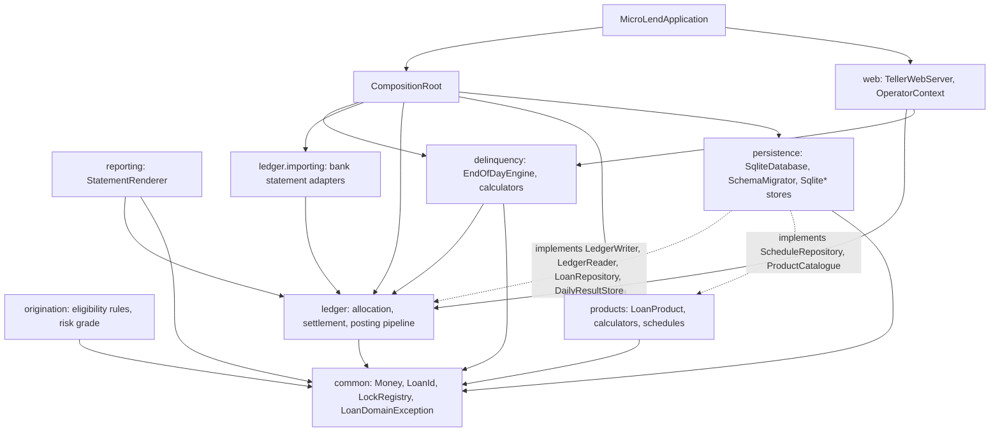
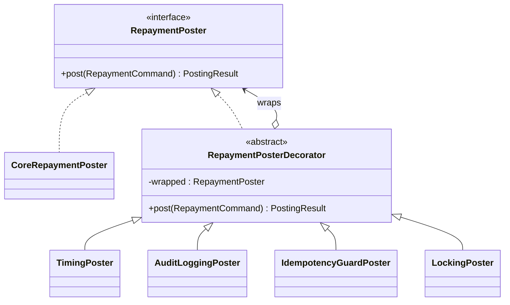
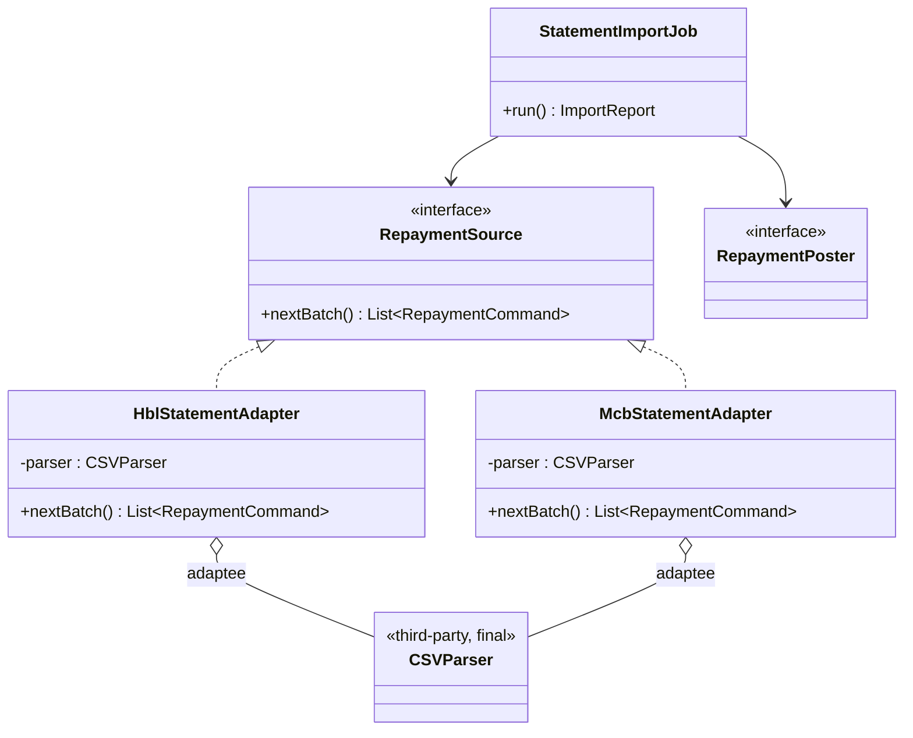

# Milestone 2 - SE423 Software Construction and Development

**Team Lead / Integrator (M2):** Muhammad Ibrahim
**Companion documents:** `docs/M1-SE423-Proposal-OOD-Pattern-Plan.md` (the M1 design), `docs/M2-SE431-Verification-Baseline.md` (quality evidence for this build).
**Build described:** `develop` at `e7ecce6` (22 Nov 2026), after the ledger (PR #8, 21 Nov), Muhammad Ibrahim's modules (PR #9, merge `ac14ba9`, 21 Nov; code head `4067d2f`) and Hassan Khalid's products and reporting work (PRs #11 to #13, 22 Nov). All numbers come from that build's output, its CI runs or Git history; none is estimated. Where a table compares, the 21 Nov figures at `4067d2f` are kept beside it.

<div class="glance">
<div class="glance-title">M2 build at a glance</div>
<div class="tiles">
<div class="tile"><div class="v">492</div><div class="l">automated tests</div><div class="s">0 failures, 0 skipped (6.2)</div></div>
<div class="tile"><div class="v">95.4%</div><div class="l">line coverage</div><div class="s">87.7% branch, JaCoCo (6.2)</div></div>
<div class="tile"><div class="v">37</div><div class="l">red/green TDD pairs</div><div class="s">19 in PR #8, 9 in PR #9, 9 in PRs #11 and #12 (6.1)</div></div>
<div class="tile"><div class="v">0</div><div class="l">Checkstyle findings</div><div class="s">zero-warning CI gate; C-01 holds (5.2)</div></div>
<div class="tile"><div class="v">4</div><div class="l">end-of-day threads</div><div class="s">per-account locks, QR-06 test (4.3)</div></div>
<div class="tile"><div class="v">5</div><div class="l">ArchUnit rules in CI</div><div class="s">no cycles, inward dependencies (1.1)</div></div>
<div class="tile"><div class="v">3</div><div class="l">GoF patterns in running code</div><div class="s">Factory Method, Decorator, Adapter (2)</div></div>
<div class="tile"><div class="v">20</div><div class="l">domain exceptions</div><div class="s">one hierarchy at the module boundary (3.2)</div></div>
</div>
<div class="segs one">
<div class="seg"><div class="seg-head"><span>Planned modules</span><span class="t">9 in all (section 0)</span></div>
<div class="seg-bar"><span class="k1" style="flex:8 1 0">8</span><span class="k2" style="flex:1 1 0">1</span></div>
<div class="seg-legend"><span><i class="k1"></i>Built</span><span><i class="k2"></i>Partly built (reporting: statement only)</span></div></div>
</div>
</div>

## 0. Module status at writing

| Module / package | Owner | State on 22 Nov 2026 | Where |
|---|---|---|---|
| `common` | shared | Done: `Money`, `LoanId`, `LoanDomainException` and two subtypes; `LockRegistry` (per-account locks) | `develop` |
| `ledger` | Tughral Hussain | Done: allocation waterfall, settlement (partial, see 1.3), posting pipeline with Decorator chain, compensating reversals | PR #8 |
| `ledger.importing` (Adapter) | Muhammad Ibrahim | Done: `HblStatementAdapter` and `McbStatementAdapter` over Apache Commons CSV, `StatementImportJob`, reachable from the application | PR #9 |
| `delinquency` (concurrent end-of-day engine) | Muhammad Ibrahim | Done: days past due, classification, penalty, provisioning, write-off threshold, `EndOfDayEngine` on four threads, classification-change events. Posting a write-off is M3 (needs the `LoanAccount` write-off transition, open item T-03) | PR #9 |
| `origination` | Muhammad Ibrahim | Done: eligibility rules BR-01 to BR-08, risk grade and amount cap BR-09 and BR-10. Creating the loan row and its schedule (I-03), which joins origination, products and the ledger, is M3 | PR #9 |
| `persistence` | Tughral Hussain; `SqliteDailyResultStore`, `SqlitePaymentReferences` and schema v2 by Muhammad Ibrahim | Done: schema v1 (7 tables) and v2 (`PENALTY_INCOME`, one reversal per entry, an eighth table `payment_reference`), `SqliteLedgerRepository`, `SqliteLoanRepository`, `SqliteDailyResultStore`, `SqlitePaymentReferences` | PR #8, PR #9 |
| `web` and composition root | Tughral Hussain; end-of-day page, `LockingPoster` wiring and statement import by Muhammad Ibrahim | Done: teller page and end-of-day page on `127.0.0.1:8080`, four request threads, `CompositionRoot` wiring both chains, the engine and the import | PR #8, PR #9 |
| `products` (Factory Method) | Hassan Khalid | Done: due dates, three interest calculators, `LoanProduct` and its ConcreteCreators, schedule assembly, grace period, golden schedules, SQLite schedule and product storage, early-settlement rebate, `ScheduleInstalmentsDueSource` wired in `CompositionRoot.production`. Paid-to-date (T-01) and the risk-graded rate are M3 (DEF-024, DEF-025) | PR #11 |
| `reporting` | Hassan Khalid | Partly built: the customer statement (`StatementRenderer`, FR-28); its running balance is wrong on balanced postings (DEF-028). Portfolio reports (H-10) are M3 | PR #12 |

Every module has code on `develop`. The review of PRs #11 and #12 logged DEF-024 to DEF-028; none is reachable in the running application, because nothing creates a loan or schedule before I-03.

## 1. Working core architecture

### 1.1 Built packages against the M1 component view

As in the M1 component view (M1 section 3.3), domain modules depend inward on `common`, `persistence` implements interfaces the domain declares, and `web` sits outside. The build now enforces this rule rather than just stating it.



`products` does not depend on `ledger`: the two meet only in the root package, where `ScheduleInstalmentsDueSource` and `ProductEarlySettlementRebate` adapt one to the other (section 2.2).

`src/test/java/pk/edu/giki/microlend/ArchitectureTest.java` (ArchUnit 1.3.0) checks five rules in `.\gradlew.bat build` and in CI:

| Rule | ArchUnit check | Source |
|---|---|---|
| No cycles between module packages | `slices().matching("pk.edu.giki.microlend.(*)..").should().beFreeOfCycles()` | Constraint C-03 |
| `common`, `ledger`, `origination` and `delinquency` never depend on `persistence` or `web` | `noClasses()...dependOnClassesThat().resideInAnyPackage(persistence, web)` | DIP, M1 section 4.5 |
| `common` depends on no module | `noClasses()` in `common` depend on any other module | M1 section 3.3 |
| `ledger` never depends on `origination` or `delinquency` | `noClasses()` in `ledger` depend on either | M1 section 3.3 (allowed directions) |
| `origination` depends only on the kernel | `noClasses()` in `origination` depend on `ledger` or `delinquency` | M1 section 3.3 |

The last three rules were added with the new modules (`5328937`). The cycle rule also covers `products` and `reporting`; a rule keeping `products` off `ledger`, which the code already respects, is an M3 addition.

### 1.2 End-to-end path that runs today

`.\gradlew.bat run` starts `MicroLendApplication`, which builds `CompositionRoot.production(...)` over `new SqliteDatabase("jdbc:sqlite:microlend.db")` and serves the teller and end-of-day pages on the loopback address only (`InetAddress.getLoopbackAddress()`) on four request threads. `.\gradlew.bat run --args="import HBL statement.csv"` imports a bank statement instead. The app is never deployed.

Three paths run through the production wiring:

| Path | Route through the code |
|---|---|
| Teller posting | `TellerWebServer` (form) -> `AuditLoggingPoster` -> `TimingPoster` -> `LockingPoster` (account lock) -> `CoreRepaymentPoster` -> `RepaymentAllocator` + `SettlementPolicy` -> `SqliteLedgerRepository.appendAll` (one transaction) -> `SqliteLoanRepository.save` (`BEGIN IMMEDIATE`) |
| Statement import | `MicroLendApplication` -> `CompositionRoot.importStatement` -> `HblStatementAdapter` or `McbStatementAdapter` (over `CSVParser`) -> `StatementImportJob` -> `IdempotencyGuardPoster` -> `TimingPoster` -> `LockingPoster` -> `CoreRepaymentPoster` -> as above |
| End of day | `TellerWebServer` (`POST /end-of-day`) -> `EndOfDayEngine.run` -> four pool threads, one task per active loan, each under its account lock -> `SqliteDailyResultStore.record` (snapshot and penalty pair in one `BEGIN IMMEDIATE` transaction) |

Two inputs come from `products`: the instalments owed per loan (`InstalmentsDueSource`, decision D-02, read by the allocator and the engine) and the early-settlement rebate (`EarlySettlementRebate`, D-03). `CompositionRoot.production` supplies `ScheduleInstalmentsDueSource` over the saved schedule and `ProductEarlySettlementRebate`, replacing the 21 Nov placeholders with no other change to the chains. Until loan creation (I-03, M3) saves schedules, a posting to a loan with no schedule is refused with `ScheduleNotFoundException`, and its end-of-day task is listed under "Failed", having written nothing.

Each path runs end to end on a real SQLite file: `CompositionRootTest` posts through `CompositionRoot.production` from a saved schedule and refuses a loan without one (section 2.1); `StatementImportWiringTest` (2.3), `ConcurrentTellerAndEndOfDayTest` (4.3) and `TellerWebServerTest` (the end-of-day page) use a test double for the instalments owed.

### 1.3 Deviations from the M1 design, with reasons

| Deviation | M1 said | Built | Why |
|---|---|---|---|
| Allocator input type | `RepaymentAllocator.allocate()` over `products.Instalment` | Takes `ledger.InstalmentDue` (record: sequence, due date, outstanding penalty, fees, interest, principal) | M1's `Instalment` holds only principal and interest; the allocator also needs what is still owed per tier, including the penalty accrued by `delinquency`. A ledger-owned input avoids a `ledger -> products` dependency, so `ledger` compiled and tested before `products` existed. `products.Instalment` now maps onto it through `ScheduleInstalmentsDueSource` (section 2.2) |
| BR-18 / BR-19 order | "penalty -> fees -> interest -> principal, oldest first" | Tier by tier: all penalties oldest first, then fees, then interest, then principal | The rule text allows two readings. The literal one was adopted on 14 Nov 2026 (recorded under BR-19 in `docs/business-rules.md`) and confirmed as team decision D-01 on 16 Nov 2026 (`docs/planning/team-decisions.md`). Only `RepaymentAllocator` and its test would change otherwise |
| Debit leg of a repayment | Not specified | New `EntryType.PAYMENT_RECEIVED` debit balanced by one credit per tier | Without it a posting's lines cannot balance on their own (BR-23). The schema `CHECK` on `entry_type` lists it |
| Multi-line writes | `LedgerWriter.append(entry)` | Adds `LedgerWriter.appendAll(List<LedgerEntry>)`, all or nothing | A posting is 2 to 6 lines; writing them one by one could leave a half-posted repayment |
| Ledger write vs loan save | One transaction for read, allocate and write | Two transactions, both inside the account lock taken by `LockingPoster`; if the loan save fails, `CoreRepaymentPoster` appends a reversal of every line it wrote (BR-24) | The two repositories open their own connections. The lock (section 4.3) stops concurrent postings interleaving; the reversal keeps the ledger balanced (`PostingFaultInjectionTest`, 14 failure points). One transaction remains an open M3 item |
| Settlement | `SettlementPolicy` covers BR-21 and BR-22 | BR-21 advance credit and payoff detection built; the BR-22 rebate is requested through `EarlySettlementRebate`; money above the payoff is refused | The rebate differs per product type, so `products` computes it (`LoanProduct.earlySettlementRebate`, through `ProductEarlySettlementRebate`, PR #11; DEF-026 open for grace periods). No rule says how an excess over the payoff is returned, so it is refused rather than invented |
| Duplicate-reference store | `UNIQUE (source_bank, bank_reference)` on `payment` | `PaymentReferences` role; production uses `SqlitePaymentReferences` over a `payment_reference` table (schema v2), unit tests use `InMemoryPaymentReferences` | `PaymentReferences.claim` knows only bank and reference; a `payment` row also needs loan, amount and date. A table of claimed pairs makes BR-25 survive a restart now (`StatementImportWiringTest.secondImportAfterRestartIsRefused`). The claim commits before the posting, so a crash between them leaves the pair claimed; full `payment` rows in the posting transaction are M3 work |
| Separate import process | One process | `import <HBL|MCB> <file>` runs as its own process on the same database file | The per-account lock is per process and `CoreRepaymentPoster` reads the loan before its write transaction, so an import concurrent with a web posting to the same loan could lose one balance update (the ledger keeps both lines). Imports run with the server stopped until posting reads and saves in one transaction (M3, "Ledger write vs loan save" row). Recorded in `qa/defect-log.md` |
| Package `persistence` | Implementations named, package implied | Explicit `pk.edu.giki.microlend.persistence` | It holds the SQLite code apart from the domain, so the ArchUnit rule in 1.1 can be stated |
| What the engine reads | `EndOfDayEngine --> ScheduleProvider`, `DaysPastDueCalculator.daysPastDue(Schedule, LocalDate)`, `PenaltyAccruer.accrue(LoanAccount, LocalDate)` | The engine reads `ledger.InstalmentsDueSource` (instalments due by the business date, with what is still owed per tier); both calculators take that list | Decision D-02 made `InstalmentsDueSource` the one place a schedule meets payments; sharing it with the posting allocator means the engine and a teller never disagree about what is overdue. `delinquency -> ledger` is an allowed direction (M1 section 3.3) |
| Penalty balancing leg | `PENALTY_ACCRUAL` only | New `EntryType.PENALTY_INCOME` credit; schema version 2 rebuilds `ledger_entry` with it in the `CHECK` | Without a credit leg a penalty accrual cannot balance (BR-23, decision D-04, open item T-02). Version 1 is never edited; existing databases are upgraded in place (`SchemaVersion2Test`) |
| Penalty per run | `accrue(LoanAccount, LocalDate)`, one day per run | `PenaltyAccruer.accrue(owing, previousRun, businessDate)`: the penalty owed from the loan's last recorded run up to this date | An independent review found that one-day-per-run accrual loses the penalty for any date the engine is not run (a holiday, or the server down): 10,000.00 overdue across a four-day gap accrued 10.00 instead of 25.00. Accruing the difference of two cumulative figures catches up and never charges a day twice |
| Engine thread pool | `-ExecutorService pool` field | A pool created per `run` and shut down in `finally` | No pool thread outlives a run, so the application and the tests never leak threads |
| Write-off | Engine moves principal to write-off (BR-32) | Engine lists loans more than 180 days past due in `EodReport.writeOffsDue`; nothing is posted | Posting needs a `LoanAccount` write-off transition and a balanced `WRITE_OFF` pair (open item T-03, M3) |
| `ProvisioningPolicy` | `<<interface>>` | A final class mapping each `Classification` to its BR-31 percentage | Only one provisioning schedule exists; an interface with one implementation adds nothing until a second is needed |
| Parser failures | Translated into `InvalidRepaymentException` | New `InvalidStatementException` naming the file and line | `InvalidRepaymentException` describes one repayment, not a file; the handoff asked for the file and line in the message |
| Origination types | `LoanApplication`, `Applicant`, rules, `Decision`, `RiskGrade` | Adds `ProductBand` (amount and tenure limits), `RuleOutcome` (reason and detail), `InvalidLoanApplicationException`; `Decision` also holds the approved amount | `origination` may depend only on the kernel (1.1), so the limits arrive as a small record that `LoanProduct` will supply at loan creation (I-03). A rule's detail names the failing rule (BR-08) |
| Schedule-to-ledger mapping | Implied by `ScheduleProvider` | `ScheduleInstalmentsDueSource` and `ProductEarlySettlementRebate` in the root package, next to `CompositionRoot` | `products` must not depend on `ledger` (M1 section 3.3), so the mapping lives where both are visible. Payments are not yet subtracted (T-01, DEF-024) |
| Choosing the ConcreteCreator | Product chosen at loan creation | `SqliteProductCatalogue` maps the stored `product_type` to a ConcreteCreator through a lookup table | Products are loaded from the database, so one storage-side lookup turns a type code into a creator; nothing inside `products` switches on type (section 2.2) |

## 2. Design patterns implemented

| Pattern | Kind | Owner | State |
|---|---|---|---|
| Decorator (`RepaymentPoster` pipeline) | Structural | Tughral Hussain (`LockingPoster`: Muhammad Ibrahim) | Implemented, integrated in both production chains, tested |
| Adapter (bank statement adapters) | Structural | Muhammad Ibrahim | Implemented, reachable from the application through `CompositionRoot.importStatement`, tested against the production import chain |
| Factory Method (`LoanProduct`) | Creational | Hassan Khalid | Implemented, wired through `CompositionRoot.production` and `SqliteProductCatalogue`, tested with a shared calculator contract and golden schedules (section 2.2) |

### 2.1 Decorator: the repayment posting pipeline

**Problem it solves.** A posting may also have to write an audit line naming the operator (FR-31), record its elapsed time (the GQM measure) or refuse a bank reference already posted (BR-25). Which of these apply depends on the call path, and they combine (M1 section 5.3, table of call paths).

**Participants in the code:**

| GoF role | Class (`src/main/java/pk/edu/giki/microlend/ledger/`) | Queue item, green commit |
|---|---|---|
| Component | `RepaymentPoster` (interface, `post(RepaymentCommand)`) | L-08, `34a7bb7` |
| ConcreteComponent | `CoreRepaymentPoster`: reads the loan, allocates, settles, writes balanced lines, saves | L-08, `34a7bb7` |
| Decorator | `RepaymentPosterDecorator`: abstract; IS-A `RepaymentPoster` and HAS-A `RepaymentPoster` (`private final RepaymentPoster wrapped`); `post` forwards | L-09, `9f7b423` |
| ConcreteDecorator | `TimingPoster`: measures with an injected nanosecond ticker and reports to `PostingTimeRecorder`, for both success and refusal | L-09, `9f7b423` |
| ConcreteDecorator | `AuditLoggingPoster`: refuses a posting with no operator; journals posted and refused attempts to `AuditJournal` | L-10, `a43c681` |
| ConcreteDecorator | `IdempotencyGuardPoster`: claims (bank, reference) atomically through `PaymentReferences`, and releases the claim if the inner posting fails; cash passes through | L-11, `71d8b3f` |
| ConcreteDecorator | `LockingPoster`: holds the loan's lock from the shared `LockRegistry` around the inner posting (section 4.3) | I-07, `3b167bf` |



**Integrated in running code.** `CompositionRoot` builds the two chains planned at M1 over one shared `CoreRepaymentPoster`, now wrapped innermost by `LockingPoster`:

```java
final RepaymentPoster core = new LockingPoster(new CoreRepaymentPoster(
    new RepaymentAllocator(), new SettlementPolicy(rebates),
    new SqliteLoanRepository(database), instalments,
    new SqliteLedgerRepository(database), clock), locks);
this.importPoster = new IdempotencyGuardPoster(
    new TimingPoster(core, System::nanoTime, (c, elapsed, ok) -> timings.add(elapsed)),
    new SqlitePaymentReferences(database));
this.tellerPoster = new AuditLoggingPoster(
    new TimingPoster(core, System::nanoTime, (c, elapsed, ok) -> timings.add(elapsed)),
    operator, auditTrail::add, clock);
```

The guard is outermost so a duplicate is refused before anything is timed or written; the lock is innermost so it covers only the read-allocate-write sequence, not auditing or timing. `CompositionRootTest` checks both chains against SQLite: the teller chain posts, audits the operator and times; the import chain refuses a duplicate before it is timed and writes no audit line.

**Benefit, shown by the tests.** Each behaviour is one class with one test class against a stub inner poster and no database (`TimingPosterTest`, `AuditLoggingPosterTest`, `IdempotencyGuardPosterTest`, `LockingPosterTest`); `CoreRepaymentPosterTest` tests the undecorated core, the "unit tests" call path of M1 section 5.3. Open-closed held in practice: account locking arrived at M2 as one new subclass and one changed line in the root, with no edit to `CoreRepaymentPoster` or any other decorator.

**Rejected alternatives:**
- **Inheritance combinations.** Three optional behaviours would need eight subclasses, and the combination could not be chosen per call path.
- **Proxy.** Proxy controls access to one subject; here several responsibilities stack in different combinations, which is the Decorator's intent (M1 section 5.3).

### 2.2 Factory Method: `LoanProduct` as Creator (planned at M1)

M1 design (section 5.1):
- **Creator:** `LoanProduct` holds the stable `generateSchedule()` workflow and declares `protected abstract InterestCalculator createInterestCalculator()`.
- **ConcreteCreators:** `FlatRateProduct`, `ReducingBalanceProduct` and `BulletProduct` each override that method.
- **Products:** `InterestCalculator` and its three concrete calculators.
- **Rejected:** a Simple Factory `create(type)` switch, which is not the GoF pattern, as well as Abstract Factory and Singleton.

**As built** (`src/main/java/pk/edu/giki/microlend/products/`, owner Hassan Khalid, PR #11, merged 22 Nov 2026).

**Problem it solves.** The three products (BR-11) share one schedule workflow: validate the amount and tenure, build the due dates (BR-12), add any grace interest (BR-13), compute interest and principal, assemble with the rounding residue in the last instalment (BR-14). Only the interest calculation differs per product. A `switch` on product type inside that workflow would have to be reopened for every new product.

| GoF role | Class | Notes |
|---|---|---|
| Creator | `LoanProduct` (abstract) | `final generateSchedule(Money, int, LocalDate, int graceMonths)` is the stable workflow; `protected abstract InterestCalculator createInterestCalculator()` is the factory method |
| ConcreteCreators | `FlatRateProduct`, `ReducingBalanceProduct`, `BulletProduct` | each overrides only the factory method (and its own early-settlement rule, BR-22) |
| Product | `InterestCalculator` | contract in the Javadoc: non-negative `Money`, never null, HALF_EVEN at every step (BR-15) |
| ConcreteProducts | `FlatRateCalculator`, `ReducingBalanceCalculator`, `BulletCalculator` | |
| Supporting | `Schedule`, `Instalment` (immutable), `ScheduleAssembler`, `DueDateCalculator`, `GracePeriodPolicy` | the assembler puts the rounding residue in the last instalment (BR-14) and guarantees exactly `tenureMonths` instalments (BR-16) |

```mermaid
classDiagram
    class LoanProduct {
      <<abstract>>
      +generateSchedule(Money, int, LocalDate, int) Schedule
      #createInterestCalculator()* InterestCalculator
      +earlySettlementRebate(Schedule, LocalDate)* Money
    }
    class FlatRateProduct
    class ReducingBalanceProduct
    class BulletProduct
    class InterestCalculator {
      <<interface>>
      +interestSchedule(Money, BigDecimal, int) List~Money~
      +principalSchedule(Money, BigDecimal, int) List~Money~
    }
    class FlatRateCalculator
    class ReducingBalanceCalculator
    class BulletCalculator
    class ScheduleAssembler {
      +assemble(...) Schedule
    }
    LoanProduct <|-- FlatRateProduct
    LoanProduct <|-- ReducingBalanceProduct
    LoanProduct <|-- BulletProduct
    InterestCalculator <|.. FlatRateCalculator
    InterestCalculator <|.. ReducingBalanceCalculator
    InterestCalculator <|.. BulletCalculator
    LoanProduct ..> InterestCalculator : uses
    FlatRateProduct ..> FlatRateCalculator : creates
    ReducingBalanceProduct ..> ReducingBalanceCalculator : creates
    BulletProduct ..> BulletCalculator : creates
    LoanProduct --> ScheduleAssembler
```



**Why this shape.** The workflow in `LoanProduct` never writes `new` on a calculator; each ConcreteCreator is the only class that names its calculator. A fourth product is one new subclass and one new calculator, with `LoanProduct` untouched (OCP). The storage layer (`persistence.SqliteProductCatalogue`) turns the stored `product_type` into a ConcreteCreator through a lookup table, so no type switch exists inside `products` (section 1.3).

**Rejected alternatives.**
- *Simple Factory (`create(type)` switch):* not the GoF pattern, and the switch must be edited for every new product.
- *Abstract Factory:* there is one varying object, not a family of related objects.
- *Singleton:* a product holds its own rate and limits, so there are several instances; a global instance would also hide the dependency from tests.

**Integrated and tested.** `products` has 73 tests (all passing in CI, run 45028938297) and JaCoCo covers 211 of 221 lines and 90 of 110 branches:
- `InterestCalculatorContract`, an abstract test class run by `FlatRateCalculatorTest`, `ReducingBalanceCalculatorTest` and `BulletCalculatorTest`: every calculator honours the same contract (one interest and one principal amount per month, never null; principal adding up to the loan within a paisa per instalment; zero rate and zero principal handled; invalid tenure and rate refused with a typed exception), so the workflow can use any of them (LSP, M1 section 4.3);
- `LoanProductTest`: a schedule per product (TC-PRD-01), exactly `tenureMonths` instalments for tenure 1, 6 and 36 (TC-PRD-05), grace 0 to 3 and 4 refused (BR-13), amounts and tenures outside the band refused; an anonymous `LoanProduct` subclass shows that the workflow uses whatever calculator the subclass creates;
- `GoldenScheduleTest`: one schedule per product, derived by hand outside the code, under `src/test/resources/golden/` (QR-02; 30 are an M3 target);
- `CompositionRootTest.productionPostsFromTheSavedSchedule`: a teller posting allocated against a saved schedule through the production wiring.

**TDD trail** (red, green): H-01 due dates `9131012`, `d7d90a1`; H-02 calculators `ec69cff`, `b923906`; H-03 Factory Method `b0df2a5`, `37eb555`; golden schedules `9c41f38` (`test:`); H-05 grace `5c9af9e`, `9b34c55`; H-06 storage `61d35a8`, `3074d49`; H-07 rebate `61df04b`, `816f0ec`; H-08 instalment source `4ed0691`, `3fc6e01` and production wiring `be6f60a`, `297df8f`.

**Mapping to the ledger (D-02, D-03).** `ScheduleInstalmentsDueSource` and `ProductEarlySettlementRebate` sit in the root package next to `CompositionRoot`, because `products` may not depend on `ledger`. The source maps each `products.Instalment` with `dueDate <= businessDate` to `ledger.InstalmentDue`, fees zero, penalty from a constructor-supplied lookup.

**Known gaps, logged from the review of PR #11** (owner Hassan Khalid, M3; none reachable until loan creation saves a schedule): nothing is treated as paid yet, so a paid instalment would still count as owed (T-01, DEF-024); the BR-09 risk-grade spread is not applied to the rate (DEF-025); with a grace period the rebate refunds earned interest (DEF-026); at very low flat rates the interest total is off (DEF-027). The pattern itself is not affected by any of them.

### 2.3 Adapter: bank statement adapters

**Problem it solves.** Repayments also arrive as bank statements (FR-20), each bank with its own column names and order, date format, amount unit and money-in/out marker, while the posting pipeline expects one validated `RepaymentCommand`. Without an adapter, bank quirks leak into the posting code, or the core fits one bank and breaks for the next.

**Participants in the code** (`src/main/java/pk/edu/giki/microlend/ledger/importing/`, owner Muhammad Ibrahim):

| GoF role | Class | Commits |
|---|---|---|
| Target | `RepaymentSource`: `nextBatch(): List<RepaymentCommand>`; an empty batch means the statement is finished | red `d0a156d`, green `c216a87` |
| Adaptee | Apache Commons CSV `CSVParser` (third-party, `commons-csv` 1.12.0) | - |
| Adapter | `HblStatementAdapter` and `McbStatementAdapter`: each implements `RepaymentSource` and holds a `CSVParser` field (composition) | red `d0a156d`, green `c216a87` |
| Client | `StatementImportJob`: sees only a `RepaymentSource` and a `RepaymentPoster`, never a bank format | red `d0a156d`, green `c216a87` |
| Integration | `CompositionRoot.importStatement(bank, reader, fileName)` picks the adapter and runs the job over `importPoster()`; `MicroLendApplication` accepts `import <HBL|MCB> <file>` | red `a206b83`, green `ec445cc` |

The two formats differ in every way an adapter has to absorb:

| | HBL | MCB |
|---|---|---|
| Columns used | `Txn Date`, `Reference No`, `Loan Ref`, `Amount (Paisa)`, `Dr/Cr` | `Transaction ID`, `Value Date`, `Customer Reference`, `Amount (PKR)` |
| Date | `ddMMyyyy`, strict | `dd/MM/yyyy`, strict |
| Amount | whole paisa, unsigned (`254900` is 2,549.00) | rupees with at most two decimals |
| Money in or out | `CR` is a repayment; `DR` (bank charges) is skipped | positive is a repayment; negative is skipped |

Both look columns up by name (so column order and extra columns do not matter), convert amounts only through `Money.of(BigDecimal)` (C-01) and build `RepaymentCommand.bank(loanId, amount, date, bank, reference)`, which validates again.



**Defensive behaviour at the boundary.** A file is untrusted input:
- a missing column (usually the wrong bank's file) is refused in the constructor, before any row is read;
- a malformed row (bad amount or date, zero amount, blank reference or loan id, broken quoting) raises `InvalidStatementException` naming the file and physical line (blank lines included), with the cause kept;
- a UTF-8 byte-order mark before the header (from spreadsheet "CSV UTF-8" exports) is dropped, so the first column is still recognised;
- the whole file is translated before the batch is returned, so a malformed file posts nothing.

**Duplicates (BR-25).** `IdempotencyGuardPoster`, outermost in the import chain, refuses an already-posted (bank, reference) and lists it in the `ImportReport` while the rest of the file posts, because bank statements overlap in dates. The claim survives a restart (section 1.3); the same reference from two banks is two payments. Any other refusal (for example a closed loan, BR-26) stops the import.

**Integrated in running code, shown by the tests:** `HblStatementAdapterTest` and `McbStatementAdapterTest` (each mapping, skipped debit rows, every malformed row with its line number; TC-LED-08); `StatementImportJobTest` with the real `IdempotencyGuardPoster` (a duplicate in a second file refused while the rest posts, the same reference from two banks accepted; TC-LED-06); and `StatementImportWiringTest`, where an HBL statement imported through `CompositionRoot.importStatement` reduces the loan's principal in SQLite and a second import, through the same root or after a restart, posts nothing and lists both references.

**Rejected alternatives:**
- **Class Adapter.** `CSVParser` is `final` and a Java class has one superclass, so the adapter must hold the parser.
- **Facade.** A facade simplifies a subsystem behind a new interface; here the target (`RepaymentSource`) already exists and another interface must be converted into it, which is the Adapter's intent.
- **One parser with a `switch` on bank.** Every new bank would reopen that class; with adapters, a new bank is one new class and one line in `CompositionRoot.importStatement`.

**Trade-off accepted.** The two adapters repeat about 20 lines (header check and row loop) so each reads as one complete translation for its bank; a shared base class is the planned refactoring when a third bank is added.

## 3. Defensive programming and exceptions

### 3.1 Invalid objects cannot be constructed

Every value type validates in its factory or compact constructor and has no setters:

| Type | Rejects | Exception |
|---|---|---|
| `Money` (`common`) | null, negative, more than 2 decimal places; rounding is `HALF_EVEN`, explicit (C-01) | `InvalidMoneyException` |
| `LoanId` | null or blank; trims the value | `InvalidLoanIdException` |
| `LedgerEntry` (`debit`, `credit`, `reversalOf`) | any null field, a zero amount, a reversal without a reason | `InvalidLedgerEntryException` |
| `Allocation`, `InstalmentDue` | null tiers, sequence below 1 | `InvalidAllocationException` |
| `LoanAccount.restore` | null fields, an ACTIVE loan with a closure date, a CLOSED or WRITTEN_OFF loan without one | `InvalidLoanAccountException` |
| `RepaymentCommand` (`cash`, `bank`) | zero or null amount, blank bank or reference on a bank payment | `InvalidRepaymentException`, which carries the offending value and its source |
| `RepaymentAllocator.allocate` | null payment, list or element; a duplicate instalment sequence | `InvalidAllocationException` |
| `LoanApplication`, `Applicant` (`origination`) | a requested amount of zero or less, a tenure under one month, a disbursement date before the date of birth, a monthly income of 0.00 (the burden ratio divides by it), a loan history that contradicts itself | `InvalidLoanApplicationException` |
| `DelinquencyClassifier`, `PenaltyAccruer`, `WriteOffPolicy` | negative days past due | `InvalidDaysPastDueException` |
| `HblStatementAdapter`, `McbStatementAdapter` | a missing column, then any malformed row | `InvalidStatementException`, naming the file and line |
| `LoanProduct`, `Schedule`, `Instalment`, `ScheduleAssembler`, `DueDateCalculator`, calculators (`products`) | an amount or tenure outside the product band, a negative rate, a tenure below 1, a missing date, an empty schedule, mismatched date and amount counts | `InvalidScheduleException` |
| `GracePeriodPolicy` | a grace period outside 0 to 3 months (BR-13) | `InvalidGracePeriodException` |
| `StatementRenderer` (`reporting`) | a start date after the end date | `InvalidStatementRangeException` |

`persistence` re-states these as schema constraints (`SchemaMigrator`): `CHECK (debit >= 0 AND credit >= 0)`; a `CHECK` on the allowed `entry_type` values; foreign keys enforced with `PRAGMA foreign_keys = ON` on every connection (`SqliteDatabase`); money as `INTEGER` paisa (C-04); `UNIQUE (loan_id, business_date)` on `delinquency_snapshot` (BR-33); and, since schema version 2, a unique index on `ledger_entry.reverses_entry_id` (an entry is reversed at most once, BR-24) and `PRIMARY KEY (source_bank, bank_reference)` on `payment_reference` (a bank payment is claimed once, BR-25).

### 3.2 One structured hierarchy at the module boundary

All 20 domain exceptions extend the abstract `common.LoanDomainException`, which is a `RuntimeException`:

```
LoanDomainException (common, abstract)
|-- InvalidMoneyException, InvalidLoanIdException          (common)
|-- InvalidLedgerEntryException, InvalidAllocationException,
|   InvalidLoanAccountException, InvalidRepaymentException,
|   LoanClosedException, LoanNotFoundException,
|   LedgerImbalanceException, DuplicatePaymentException     (ledger)
|-- InvalidStatementException                               (ledger.importing)
|-- InvalidLoanApplicationException,
|   IneligibleApplicantException                            (origination)
|-- InvalidDaysPastDueException                             (delinquency)
|-- InvalidScheduleException                                (products)
|   `-- InvalidGracePeriodException
|-- ScheduleNotFoundException                               (products)
|-- InvalidStatementRangeException                          (reporting)
|-- PersistenceException                                    (persistence)
`-- ModuleNotAvailableException                             (composition root)
```

Each carries the data that explains the failure: `LoanClosedException` the loan id, status and closure date (BR-26); `LedgerImbalanceException` both totals (BR-23); `DuplicatePaymentException` the bank and reference (BR-25); `InvalidStatementException` the file name and line number; `IneligibleApplicantException` the failing rule's outcome, whose detail names the rule (BR-08); `ModuleNotAvailableException` the missing module and its owner.

One loan's failure never escapes an end-of-day run: the task's exception is caught through its `Future` and reported in `EodReport.failures` with the cause, and nothing was written because its storage transaction rolled back.

JDBC failures never cross the boundary: `SqliteLedgerRepository` and `SqliteLoanRepository` roll back (`appendAll`, `save`), then rethrow the `SQLException` as a `PersistenceException` with the cause attached. Production code has no `catch (Exception e)` and no empty catch.

### 3.3 Error reporting

- `AuditLoggingPoster` records every refused teller posting with its reason before rethrowing.
- `TellerWebServer` shows a `LoanDomainException` as its message, not a stack trace; the end-of-day page lists each failed loan with its reason, HTML-escaped.
- `CoreRepaymentPoster` attaches a failed reversal to the original failure as a suppressed exception, so neither is lost.

Structured logging beyond the audit journal is deferred to M3 (static analysis finding SA-03).

## 4. Concurrency and thread safety

### 4.1 The planned concurrent operation (M1 section 3.6)

M1 planned a four-thread end-of-day engine, one task per loan, running while tellers post to the same accounts, and three races to prevent: lost updates, double penalty accrual for one business date and torn reads in reports. Sections 4.2 and 4.3 show what the code does about each.

### 4.2 What the built code already guarantees

| Measure in the code | Where | Race it addresses |
|---|---|---|
| Immutable value types: `Money`, `LoanId`, `LedgerEntry`, `Allocation`, `InstalmentDue`, `RepaymentCommand`, `LoanAccount`. `applyAllocation` returns a new account | `common`, `ledger` | Nothing shared can change under another thread. `LedgerImmutabilityTest` checks by reflection that `LedgerEntry` is final with final fields and no mutators |
| Stateless services: `RepaymentAllocator`, `SettlementPolicy`, `CoreRepaymentPoster` hold only final collaborators | `ledger` | One instance is shared by both chains and by any number of teller threads |
| One connection per call: every repository method opens its own connection through `SqliteDatabase.connect()` and closes it | `persistence` | No JDBC connection is shared between threads |
| `BEGIN IMMEDIATE` for every loan save, with `PRAGMA busy_timeout = 5000` on every connection | `SqliteLoanRepository.save`, `SqliteDatabase` | Takes SQLite's write lock up front, so two writers queue for up to 5 s instead of one failing. Alone it does **not** prevent a lost update: `CoreRepaymentPoster` reads the loan before the transaction starts, so two postings can read the same balance. The PR #8 review found this; the per-account lock in 4.3 closes it |
| All-or-nothing ledger writes: `appendAll` in one transaction, rolled back on any failure | `SqliteLedgerRepository` | No half-posted repayment is visible to a concurrent reader |
| Exactly-once schema migration: `volatile boolean migrated` with double-checked locking in `synchronized` | `SqliteDatabase.ensureMigrated` | Several workers connecting at start-up cannot migrate twice |
| Atomic duplicate claims: `claim` is one `INSERT OR IGNORE` into `payment_reference` under SQLite's write lock against the primary key, so of two concurrent claims of one (bank, reference) exactly one inserts a row (`SqlitePaymentReferencesTest`, eight latch-started threads). The in-memory test double uses a single `add` on `ConcurrentHashMap.newKeySet()` | `SqlitePaymentReferences`, `IdempotencyGuardPoster` | A bank payment imported twice at the same moment, or again after a restart, is posted once (BR-25) |
| Thread-safe collectors: audit trail and timings are `CopyOnWriteArrayList`; accessors return copies | `CompositionRoot` | Teller threads append while the web page reads |

### 4.3 End-of-day engine and `LockRegistry` (owner Muhammad Ibrahim)

**The operation.** `EndOfDayEngine.run(businessDate)` (`delinquency`, green commit `70428a8`) lists the active loans and submits one task per loan to `Executors.newFixedThreadPool(4)`. Each task:
1. takes the loan's lock from the shared `LockRegistry`;
2. skips the loan as already recorded if its last snapshot is for this business date or later;
3. reads what is owed through `InstalmentsDueSource`;
4. computes days past due (`DaysPastDueCalculator`, BR-29), the classification (`DelinquencyClassifier`, BR-30), the penalty owed since the last run (`PenaltyAccruer`, BR-27 and BR-28) and whether a write-off is due (`WriteOffPolicy`, BR-32);
5. records the snapshot and a balanced `PENALTY_ACCRUAL`/`PENALTY_INCOME` pair through `DailyResultStore.record`, in one storage transaction;
6. releases the lock.

A skipped date is caught up by the next run (section 1.3); a loan never processed before accrues every overdue day. The engine collects each task's `Future` into an `EodReport` (loans recorded, already recorded for that date, penalty accrued, classification changes (BR-34), write-offs due, per-loan failures) and shuts the pool down in `finally`.

**The three races of M1 section 3.6, and what stops each one:**

| Race | Prevented by | Where |
|---|---|---|
| Lost update: two postings, or a posting and the engine, read the same account and both write back | `LockRegistry` (`ConcurrentHashMap<LoanId, ReentrantLock>`, locks created atomically by `computeIfAbsent`). The engine's task and `LockingPoster`, innermost in both posting chains, take the same lock for the same loan, so one account's read-allocate-write never interleaves with another on that account; different accounts run in parallel | `common.LockRegistry`, `ledger.LockingPoster` (`3b167bf`), `EndOfDayEngine.process` |
| Double penalty accrual: the engine run twice for one date (a retry, or two runs at once), or an earlier date run after a later one | Under the account lock the task skips a loan whose last snapshot is this date or later. Across processes, `SqliteDailyResultStore.record` opens `BEGIN IMMEDIATE`, checks for an existing snapshot, inserts the snapshot and penalty lines and commits; the write lock spans the check, so two racing records cannot both pass it, and `UNIQUE (loan_id, business_date)` is the second line of defence. A repeated date writes nothing and counts as "already recorded" (BR-33) | `persistence.SqliteDailyResultStore` |
| Torn read: a report sums balances mid-update | Writes that belong together commit in one transaction (`appendAll`; snapshot plus penalty pair). The statement (`reporting`, PR #12) reads committed entries through `LedgerReader`; the portfolio report, and with it the snapshot-read half of this measure, is M3 work | `SqliteLedgerRepository`, `SqliteDailyResultStore` |

**Why it cannot deadlock.** A task or a posting holds exactly one account lock, its own loan's, and nothing in scope moves money between accounts, so no thread holds one account lock while waiting for another. Inside it the only other wait is SQLite's write lock, always released by commit or rollback before the account lock.

**What runs in parallel and what is serialised.** The four threads read and calculate in parallel; SQLite admits one writer, so the short commits queue on its write lock (5-second busy timeout). Whether this is fast enough for 10,000 loans is QR-01, measured at M3 rather than assumed.

**Tests** (all deterministic: latches and lock queues, never `Thread.sleep`):

| Test | What it shows |
|---|---|
| `EndOfDayEngineTest.runsFourTasksInParallel` | Four tasks are inside the engine at the same moment: each counts down a latch of 4 and waits for it, which only completes if the pool really runs four at once |
| `EndOfDayEngineTest.workRunsUnderTheAccountLock` | Every read and write of a loan happens while the task holds that loan's lock (`isHeldByCurrentThread`) |
| `EndOfDayEngineTest.idempotentPerBusinessDate` | A second run for the same date records nothing and accrues nothing; the next date accrues again (TC-DEL-06) |
| `EndOfDayEngineTest.catchesUpSkippedDates`, `earlierDateAfterALaterRunIsSkipped` | After a four-day gap the next run accrues exactly the four missing days; a backdated run after a later one records and accrues nothing |
| `EndOfDayEngineTest.failingTaskDoesNotBlockThePool` | One loan's task throws; the other nine are recorded and the failure is reported with its cause |
| `EndOfDayEngineTest.classificationChangeEvents` | A downgrade and an upgrade raise one event each; no change raises none (TC-DEL-07) |
| `LockingPosterTest.waitsForTheHolder` | A posting to a locked account queues on the lock and does not reach the core until the holder releases it; another account is not held up |
| `LockRegistryTest.concurrentRequestsShareOneLock` | Eight threads released together all receive the same lock for one account |
| `SqliteDailyResultStoreTest.concurrentRecordsForTheSameDate` | Two connections record the same loan and date at once against a real SQLite file: exactly one succeeds, one snapshot and one penalty pair exist |
| `SqliteDailyResultStoreTest.oneTransaction` | A failing penalty line rolls the snapshot back with it |
| `ConcurrentTellerAndEndOfDayTest` (QR-06) | Four teller threads post 100 payments across five loans through `CompositionRoot.tellerPoster()` while `endOfDayEngine().run` processes the same loans, all on one SQLite file. Afterwards every loan's principal is exactly the sequential result, debits equal credits across the whole ledger, and each loan has one snapshot and one penalty pair |

The last test was checked against the fault it targets: with `LockingPoster` removed from the chains it failed in 3 of 3 runs, reporting `LN-1 lost a posting: expected 49800.00 but was 49900.00` (ten teller postings had overwritten one another); with the lock in place it passes. QR-06's M3 target is 50 consecutive clean runs; the two injected failure scenarios of M1 section 3.6 are also M3 work.

**Stated limit.** The lock registry is per process; a separate import process (`gradlew run --args="import ..."`) is not covered, so imports run with the server stopped until M3 (section 1.3).

**The teller side.** `TellerWebServer` once served one request at a time on the JDK default executor, so "teller threads" existed only in tests. It now serves on four threads (`TellerWebServerTest.servesRequestsConcurrently`: two postings inside the poster at once); `OperatorContext` is a `ThreadLocal`, so the operator name stays per request.

## 5. Code quality and SOLID

### 5.1 Each principle, in the built code

| Principle | Evidence in code | Why it matters here |
|---|---|---|
| **SRP** | `RepaymentAllocator` only computes an `AllocationResult`. `SettlementPolicy` only decides advance credit or payoff. `CoreRepaymentPoster` only writes lines and saves. Each decorator adds one behaviour. In `delinquency` each rule has its own class: `DaysPastDueCalculator` (BR-29), `DelinquencyClassifier` (BR-30), `PenaltyAccruer` (BR-27, BR-28), `ProvisioningPolicy` (BR-31), `WriteOffPolicy` (BR-32); `EndOfDayEngine` only orchestrates them under locks. Each origination rule is one `EligibilityRule` class. In `products`, `DueDateCalculator`, `GracePeriodPolicy`, `ScheduleAssembler` and each calculator do one step of the schedule | A change to the waterfall order (for example the BR-19 reading) or to one delinquency bucket touches one class and one test class |
| **OCP** | New posting behaviour is a new `RepaymentPosterDecorator` subclass plus one line in `CompositionRoot`: `LockingPoster` was added at M2 exactly that way. A new eligibility rule is a new `EligibilityRule` added to the evaluator's list; a new bank is a new `RepaymentSource` adapter; a new product is a new `LoanProduct` subclass and calculator (2.2). None of these edits an existing class | L-09 to L-11 and I-07 were added without reopening `CoreRepaymentPoster` |
| **LSP** | Every decorator and `CoreRepaymentPoster` honour the `RepaymentPoster` contract: same inputs, a `PostingResult`, or a `LoanDomainException` passed through unchanged. Both bank adapters honour `RepaymentSource` (validated commands; an empty batch means finished), so `StatementImportJob` runs either one unchanged. Every `EligibilityRule` returns a `RuleOutcome` and never throws for an ineligible applicant | `CompositionRootTest` uses both chains where a `RepaymentPoster` is expected; `StatementImportJobTest` runs the same job over both adapters; `InterestCalculatorContract` runs one set of assertions against all three calculators (2.2) |
| **ISP** | Role interfaces, not one DAO: `LedgerWriter` (append, appendAll), `LedgerReader` (entriesFor), `LoanRepository`, `PaymentReferences`, `AuditJournal`, `PostingTimeRecorder`, `InstalmentsDueSource`, `EarlySettlementRebate`, for the engine `DailyResultStore` (three methods: active loans, last snapshot, record), and in `products` `ScheduleRepository` and `ProductCatalogue` | `CoreRepaymentPoster` receives a `LedgerWriter` and cannot read the ledger. The engine's whole storage need is one small role, so its tests use a small in-memory store (`InMemoryDailyResultStore`) |
| **DIP** | `ledger` declares `LedgerWriter`, `LedgerReader` and `LoanRepository`; `delinquency` declares `DailyResultStore`; `products` declares `ScheduleRepository` and `ProductCatalogue`. `persistence` implements them. Only `CompositionRoot` builds the infrastructure graph; the entry point `MicroLendApplication` only opens the database file and hands it over. No domain class imports `java.sql` | Enforced by `ArchitectureTest.domainDoesNotDependOnInfrastructure`, which now covers `origination` and `delinquency`. The ledger suite runs on in-memory repositories; the engine suite on `InMemoryDailyResultStore` |

### 5.2 Cohesion, coupling and measured quality

- **Coupling.** One-directional and checked by ArchUnit (1.1); the heaviest dependency, `persistence -> ledger`, runs in the intended direction.
- **Complexity.** The highest V(G) is 12, the `origination.Applicant` constructor (validation guards); none exceeds the Checkstyle limit of 15. On the money path the highest is `RepaymentAllocator.allocate` (McCabe V(G) = 10, JaCoCo agrees), kept whole on purpose as the Fagan inspection target planned at M1. `DelinquencyClassifier.classify`, the delinquency module's white-box target, has V(G) = 6 (one guard, five buckets). Full tables: `qa/test-design/white-box.md`.
- **Static analysis.** Checkstyle 10.18.2 is a zero-warning CI gate with 0 findings, so C-01 holds (no `double` or `float`). PMD 7.7.0 reports 122 open findings on the 22 Nov build, all triaged in `qa/static-analysis-report.md`: 10 accepted, 28 deferred to M3 refactoring (DEF-029, DEF-030 for the 8 new in `products`) and 84 false positives with reasons. Of the 66 on the ledger code, 4 were fixed (`e3f585d`, `701c161`).
- **Known weaknesses kept for M3 refactoring evidence:** the guard-clause runs in `LoanAccount.restore` and `LedgerEntry.requireValid`, and `TellerWebServer` doing routing, parsing and rendering in one class (DEF-004, DEF-005).

## 6. TDD and test baseline

### 6.1 Red-green-refactor history

Each queue item in `docs/planning/m2-code-todo.md` is a `test(red):` commit with the failing test, then a `feat(green):` commit. PR #8 has **19 red/green pairs** (L-01 to L-19), then 2 `refactor:` commits (`6a93ca4` shared `Paisa` converter, `e3f585d` `isBlank`) and 1 `fix:` commit (`701c161`).

| Item | Red | Green | Item | Red | Green |
|---|---|---|---|---|---|
| L-01 | `131164a` | `d09780d` | L-11 | `3a85d3e` | `71d8b3f` |
| L-02 | `ba36509` | `b6a0c4f` | L-12 | `d34dffa` | `48f9378` |
| L-03 | `c6bfa3e` | `61febe9` | L-13 | `32ea473` | `c04b41c` |
| L-04 | `89063cc` | `512cd86` | L-14 | `8be61ef` | `92210a7` |
| L-05 | `e386629` | `c17052f` | L-15 | `65266d9` | `c2e3879` |
| L-06 | `4a353b4` | `c80b9c9` | L-16 | `535fa82` | `5502ccf` |
| L-07 | `db4b263` | `40586be` | L-17 | `33efd9a` | `038bd08` |
| L-08 | `83934ce` | `34a7bb7` | L-18 | `69f3d76` | `9db0657` |
| L-09 | `81b1a2f` | `9f7b423` | L-19 | `5835019` | `e0f9ecb` |
| L-10 | `4f79a3c` | `a43c681` | | | |

Most red commits fail to compile because the type under test does not exist yet. L-16 is a genuine behavioural red: `PostingFaultInjectionTest` failed at 3 of its 14 failure points, where a failed loan save left the posting's lines in the ledger; green commit `5502ccf` added the compensating reversal. Merge-commit-only merges (section 7) keep this history intact on `develop`.

PR #9 (Muhammad Ibrahim) adds **9 red/green pairs**:

| Item | What | Red | Green |
|---|---|---|---|
| I-05 | Delinquency calculators, BR-27 to BR-32 | `fd5e402` | `9cab692` |
| I-06, I-09, T-02 | End-of-day engine, `LockRegistry`, `SqliteDailyResultStore`, schema v2 | `87a7796` | `70428a8` |
| I-07, I-08 | `LockingPoster`, wiring, end-of-day page, four request threads | `16d8ea5` | `3b167bf` |
| I-04 | Bank statement adapters and import job | `d0a156d` | `c216a87` |
| I-04 | Import reachable from the application | `a206b83` | `ec445cc` |
| I-01 | Origination eligibility rules BR-01 to BR-08 | `d962c75` | `da2c929` |
| I-02 | Risk grade and capped amount BR-09, BR-10 | `a7681e3` | `1eb0f25` |
| Review | Fixes from an independent review of this code: penalty catch-up after a skipped date (BR-27), no accrual for a backdated run, physical line numbers and byte-order mark in imports, a 503 for a failed end-of-day run | `5541f0b` | `6d30af9` (`fix:`) |
| FR-18 | Duplicate references survive a restart (`SqlitePaymentReferences`, BR-25) | `5b758e9` | `8401031` |

Every red commit failed before its green, most by failing to compile. Between I-07's red and green, `test:` commit `11d2c7d` corrected a test double that built an invalid `PostingResult` (no assertion changed), so green commit `3b167bf` contains production code only. Two more `test:` commits extend the architecture rules to the new modules (`5328937`) and remove a start-up race from the concurrent claim test (`2a64b0a`). The adapter, origination and durable-reference pairs came in on their own branches through merge commits, keeping their place in the history.

PRs #11 and #12 (Hassan Khalid) add **9 red/green pairs**: eight in `products` (listed in section 2.2) and one in `reporting`, H-09 `StatementRenderer` (red `3c7ffb0`, green `57ccdc6`). Each red commit contains only test code and fails to compile against the not-yet-written type; a `test:` commit (`9c41f38`) adds the golden schedules.

### 6.2 Tests and coverage

`.\gradlew.bat build jacocoTestReport` after each integration step:

| Measure | `701c161` (PR #8) | `4067d2f` (PR #9) | 22 Nov (PRs #11 to #13) |
|---|---|---|---|
| Tests | 182, 0 failures, 0 skipped | 384, 0 failures, 0 skipped | 492 in 69 classes, 0 failures, 0 skipped |
| Line coverage (JaCoCo) | 773 / 818 = 94.5% | 1309 / 1375 = 95.2% | 1680 / 1761 = 95.4% |
| Branch coverage | 244 / 282 = 86.5% | 437 / 492 = 88.8% | 563 / 642 = 87.7% |
| Method coverage | 184 / 188 = 97.9% | 294 / 298 = 98.7% | 390 / 394 = 99.0% |

Coverage of the packages added at M2:

| Package | Lines | Branches |
|---|---|---|
| `delinquency` | 148 / 152 | 52 / 54 |
| `origination` | 159 / 159 | 84 / 90 |
| `ledger.importing` | 99 / 102 | 30 / 32 |
| `products` | 211 / 221 | 90 / 110 |
| `reporting` | 65 / 65 | 16 / 16 |

Tests run against real logic and, for persistence, a real SQLite file: allocator boundaries at 0.00, 0.01, due - 0.01 and exactly due (BR-20); the BR-23 invariant after every posting (`CoreRepaymentPosterTest.ledgerBalancesAfterEveryPosting`) and across the whole ledger after concurrent tellers and end of day (`ConcurrentTellerAndEndOfDayTest`); fault injection at 14 write points (`PostingFaultInjectionTest`); every black-box boundary of the delinquency and origination rules, TC-DEL-01 to TC-DEL-07 and TC-ORG-01 to TC-ORG-07 (`qa/test-design/black-box.md`); golden schedules and the calculator contract for `products`; the schema upgrade (`SchemaVersion2Test`), both web pages (`TellerWebServerTest`) and the architecture rules (`ArchitectureTest`).

The 60% gate (`coverageGate`) is required at M3. The lowest-covered package is the root (`CompositionRoot`, `MicroLendApplication` and the two `products` adapters: 54 of 72 lines), because `main` runs only in the live application.

## 7. Repository discipline

Full evidence, collected from the GitHub API: `qa/scm-evidence.md`.

- **Branching.** `main` holds baselines (`m1-baseline` = `10688c2`), `develop` integrates, and work happens on `feature/<module>-<name>` branches (table below); the adapter and origination work had their own branches, merged into `feature/delinquency-origination-import`.
- **Controls.** Ruleset `main-protection` covers `main` and `develop` with no bypass. It requires one approval from someone other than the last pusher (stale approvals dismissed), resolved review threads, and merge commits only, with no force push or deletion. Squash and rebase are off at the repository level.
- **CI.** `.github/workflows/build.yml` runs compile, test, Checkstyle and JaCoCo on every push and pull request. Every push to `feature/ledger-entry` passed.
- **Attribution.** Each member works on their own branch and pull request under their own GitHub account: ledger by Tughral Hussain (PR #8), origination, delinquency and import by Muhammad Ibrahim (PR #9), products and reporting by Hassan Khalid (PRs #11 to #13). Commit counts are uneven (risk R6, `qa/risk-register.md`). Hassan Khalid's 20 commits were authored by the tool that generated them, with trailer lines; before merge they were re-authored to him on his own feature branches, message and author only, every tree verified identical. `develop` and `main` were not rewritten.
- **Honest finding.** Pull requests #1 to #5 and #7 merged without an approving review, five by their own author, through the ruleset's admin bypass (DEF-006). The bypass list was emptied on 4 Nov 2026 (CAPA-001); PR #8 was the first held by the non-author approval gate.

**Integration at M2:**

| Step | Author | Reviewer and outcome | Merged |
|---|---|---|---|
| PR #8, `feature/ledger-entry` -> `develop` | Tughral Hussain | Muhammad Ibrahim, 21 Nov 2026: approved with seven follow-ups recorded in the review (the defects raised from it are in `qa/defect-log.md`) | 21 Nov 2026, merge commit `47c713e` |
| PR #9, `feature/delinquency-origination-import` -> `develop` | Muhammad Ibrahim | Tughral Hussain, 21 Nov 2026: approved; CI passed (run 44930290499) | 21 Nov 2026 by the reviewer, merge commit `ac14ba9`; `develop` CI passed (run 44931805244) |
| PR #11 `feature/products-m2`, PR #12 `feature/reporting-statement`, PR #13 `docs/hassan-m2-records` -> `develop` | Hassan Khalid | Muhammad Ibrahim, 22 Nov 2026: approved with follow-ups (DEF-024 to DEF-028); CI passed on each (runs 45028938297, 45028943565, 45028949262) | 22 Nov 2026 by the reviewer, merge commits `318bad6`, `4309bf1`, `e7ecce6`; `develop` CI passed (run 45030126014) |
| `develop` -> `main` ("M2 baseline") | Muhammad Ibrahim | a non-author approval, recorded on that pull request | merge commit on `main`; it carries this document |
| Tag `m2-baseline` | Muhammad Ibrahim | annotated, on that merge commit | `git rev-list -n 1 m2-baseline` |

Controlled exception: one approved, message-only force push to `develop` on 21 Nov 2026 (trees verified identical, ruleset re-enabled at once, the 141 quoted hashes updated in `7784a6a`). Full record: `qa/scm-evidence.md` section 3.6.
