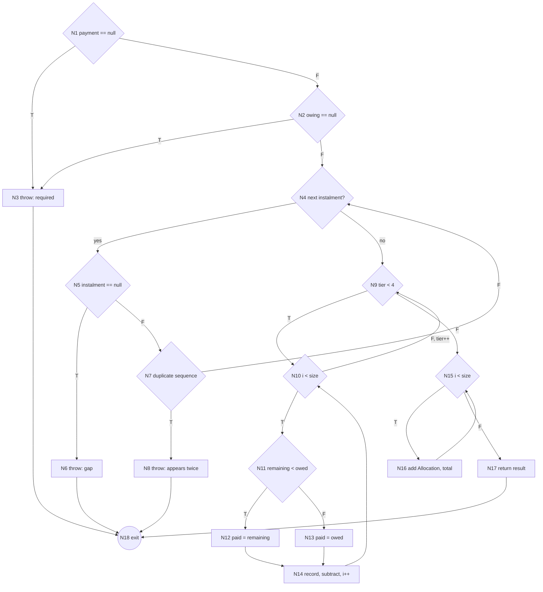

# MicroLend - White-Box Test Design (M2)

**Deliverable:** SE431 M2, "White-box test design" · **Document lead:** to be assigned (M2 leads not yet chosen)
**Code baseline:** `feature/ledger-entry` at `923755b` (14 Nov 2026). Re-checked against the M2 build before submission.
**Tools:** control-flow graphs drawn by hand from the source; complexity cross-checked with JaCoCo 0.8 (`build/reports/jacoco/test/jacocoTestReport.xml`, `COMPLEXITY` counter) and PMD 7.7.0 (`CyclomaticComplexity` rule).

## 1. Method

1. Draw the control-flow graph (CFG) of the method. Each node is a block of statements with one entry and one exit. Compound conditions (`a || b`) are split into one decision node per simple condition, because each one is a separate branch in the bytecode and in the coverage report.
2. Compute cyclomatic complexity three ways and check that they agree:
   - `V(G) = E - N + 2` (edges, nodes, one connected component);
   - `V(G) = P + 1`, where P is the number of simple decision nodes;
   - JaCoCo's `COMPLEXITY` counter for the method.
3. Derive V(G) linearly independent basis paths. Start from a typical baseline path, then flip one decision at a time.
4. Give each feasible path a concrete test case, with inputs and the expected result, and name the automated test that executes it. Infeasible paths are stated and explained, not hidden.

### Selection of methods

These methods were chosen because they are on the money path and have the highest complexity on it. They are also the Fagan inspection target (`qa/inspections/INS-01-repayment-path/`).

| Method | Requirement | Why it is "key" |
|---|---|---|
| `RepaymentAllocator.allocate(Money, List<InstalmentDue>)` | FR-13, FR-14 (BR-18, BR-19, BR-20) | Decides where every rupee of every repayment goes; an error here corrupts penalties, ageing and provisioning downstream (risk R1) |
| `LoanAccount.restore(LoanId, LoanStatus, Money, LocalDate)` | FR-19 (BR-26) | Guards the status/closure-date invariant every repository load relies on |
| `LedgerEntry.requireValid(LoanId, EntryType, Money, Instant)` | FR-17 (BR-23, BR-24) | Gate for every ledger line; a zero or incomplete entry breaks the balanced-ledger invariant |
| `CoreRepaymentPoster.post(...)` | FR-16 (BR-23) | Added when queue item L-08 lands, using the same method |

### Complexity summary

| Method | P (simple decisions) | E | N | V(G) = E - N + 2 | JaCoCo | PMD 7.7.0 | Branch coverage (JaCoCo) |
|---|---|---|---|---|---|---|---|
| `RepaymentAllocator.allocate` | 9 | 26 | 18 | **10** | 10 | 13 | 18 / 18 |
| `LoanAccount.restore` | 7 | 22 | 16 | **8** | 8 | 13 | 14 / 14 |
| `LedgerEntry.requireValid` | 5 | 16 | 12 | **6** | 6 | 11 | 10 / 10 |

PMD's figure is higher by exactly the number of `throw` statements in each method (3, 5 and 5). That is consistent with PMD counting each `throw` as an extra decision. The McCabe value from the graph, which JaCoCo confirms, is the one used for basis paths. The M1 RTM estimated "CC about 11" for the allocator, and the built method came in at 10.

---

## 2. `RepaymentAllocator.allocate`

Source: `src/main/java/pk/edu/giki/microlend/ledger/RepaymentAllocator.java`. Tier-by-tier reading of BR-18/BR-19, adopted 14 Nov 2026 pending team confirmation.

### 2.1 Nodes

| Node | Statement(s) | Decision |
|---|---|---|
| N1 | `if (payment == null` | P1 |
| N2 | `\|\| owing == null)` | P2 |
| N3 | `throw` "a payment and a list ... are required" | |
| N4 | create `sequences`; `for (instalment : owing)`, has next? | P3 |
| N5 | `if (instalment == null)` | P4 |
| N6 | `throw` "... has a gap" | |
| N7 | `if (!sequences.add(instalment.sequence()))` | P5 |
| N8 | `throw` "instalment n appears twice" | |
| N9 | sort oldest first; create `applied`; `remaining = payment`; `tier < TIERS.size()`? | P6 |
| N10 | `i < oldestFirst.size()`? | P7 |
| N11 | `owed = tier(i)`; `remaining.compareTo(owed) < 0`? | P8 |
| N12 | `paid = remaining` (partial, BR-20) | |
| N13 | `paid = owed` (tier cleared) | |
| N14 | `applied[i][tier] = paid; remaining -= paid; i++` | |
| N15 | build `bySequence`, `total`; `i < oldestFirst.size()`? | P9 |
| N16 | add the instalment's `Allocation` and accumulate the total | |
| N17 | `return new AllocationResult(total, bySequence, remaining)` | |
| N18 | exit | |

### 2.2 CFG

E = 26, N = 18, so **V(G) = 26 - 18 + 2 = 10**, which equals P + 1 = 9 + 1.

### 2.3 Basis paths and test cases

The baseline is BP-1: one instalment, and a payment that clears it exactly. Each later path flips one decision from a path already listed.

| Path | Route | Decision flipped | Test input (money in PKR) | Expected result | Closest automated test in `RepaymentAllocatorTest` |
|---|---|---|---|---|---|
| BP-1 | N1F N2F N4 N5F N7F N4 N9 N10 N11F N13 N14 ... N9F N15T N16 N15F N17 | baseline | 1 instalment (penalty 10.00, fees 0.00, interest 50.00, principal 200.00); payment 260.00 | each tier paid in full; unapplied 0.00 | `conservesThePayment`, `principalLast` |
| BP-2 | N1T N3 | P1 | payment `null`, 1 instalment | `InvalidAllocationException` | `Validation.rejectsMissingInput` |
| BP-3 | N1F N2T N3 | P2 | payment 100.00, list `null` | `InvalidAllocationException` | `rejectsMissingInput` |
| BP-4 | N1F N2F N4 N5T N6 | P4 | list `[null]` | `InvalidAllocationException` ("gap") | `rejectsMissingInput` |
| BP-5 | ... N7F N4 N5F N7T N8 | P5 | two instalments, both sequence 1 | `InvalidAllocationException` ("appears twice") | `rejectsDuplicateSequence` |
| BP-6 | N1F N2F N4(no) N9 N10F ... N9F N15F N17 | P3, P7 and P9 at zero iterations | payment 100.00, empty list | nothing allocated; unapplied 100.00 | `nothingOwed` |
| BP-7 | ... N11T N12 N14 ... | P8 | 1 instalment as BP-1; payment 30.00 | penalty 10.00, interest 20.00, principal 0.00; unapplied 0.00 | `partOfEachTier` |
| BP-8 | baseline with N10T and N15T taken twice per pass | P7, P9 (second iteration) | 2 instalments, due 10 Oct and 10 Nov (each penalty 5.00, interest 20.00, principal 100.00); payment 30.00 | both penalties 5.00 + 5.00 first, then 20.00 interest on the oldest; newest interest 0.00 | `twoOverdueTierByTier` |
| BP-9 | as BP-8, but the list is passed newest first | sort order feeding P7 | 3 instalments given out of due-date order | paid by due date, not by list position (BR-19) | `threeOverdueOutOfOrder` |
| BP-10 | N9F on first evaluation | P6 | none | **Infeasible.** `TIERS` is a constant list of 4 tiers, so the tier loop always runs 4 times | n/a (by inspection) |

BVA cases for the same method (0.00, 0.01, due - 0.01, exactly due, due + 0.01) are in `qa/test-design/black-box.md`, TC-LED-01 and TC-LED-02. They are automated in the parameterised `boundaries` test and in `oneRupeeShortOnNewestPrincipal`.

---

## 3. `LoanAccount.restore`

Source: `src/main/java/pk/edu/giki/microlend/ledger/LoanAccount.java`.

| Node | Statement | Decision |
|---|---|---|
| N1 | `if (id == null)` | P1 |
| N2 | `if (status == null)` | P2 |
| N3 | `if (outstandingPrincipal == null)` | P3 |
| N4 | `if (status == ACTIVE` | P4 |
| N5 | `&& closedOn != null)` | P5 |
| N6 | `if (status != ACTIVE` | P6 |
| N7 | `&& closedOn == null)` | P7 |
| N8 to N12 | five `throw new InvalidLoanAccountException(...)` | |
| N13 | `return new LoanAccount(...)` | |
| N14 | exit | |

There are 7 decision nodes, 7 other nodes and the exit. N4F and N5F both lead to N6, and N6F and N7F both lead to N13. Each throw node and N13 lead to the exit. E = 22, N = 16, **V(G) = 8**.

| Path | Decisions | Input | Expected | Automated in `LoanAccountTest` |
|---|---|---|---|---|
| BP-1 | P1..P3 F, P4 T, P5 F, P6 F | ACTIVE, closedOn null | account created, `isClosed()` false | `activeAccountState`, `activeLoanAcceptsPayment` |
| BP-2 | P1 T | id null | `InvalidLoanAccountException` | `rejectsNullFields` |
| BP-3 | P2 T | status null | `InvalidLoanAccountException` | `rejectsNullFields` |
| BP-4 | P3 T | principal null | `InvalidLoanAccountException` | `rejectsNullFields` |
| BP-5 | P4 T, P5 T | ACTIVE with closedOn 2026-11-01 | `InvalidLoanAccountException` | `activeAccountHasNoClosureDate` |
| BP-6 | P4 F, P6 T, P7 T | CLOSED, closedOn null | `InvalidLoanAccountException` | `closedAccountNeedsClosureDate` |
| BP-7 | P4 F, P6 T, P7 F | CLOSED, closedOn 2026-11-01 | account created, `isClosed()` true | `restoredClosedAccountState`, `closedLoanRejectsPayment` |
| BP-8 | P4 F, P6 T, P7 F, status WRITTEN_OFF | WRITTEN_OFF, closedOn 2026-11-01 | account created; payment then rejected (BR-26) | `writtenOffLoanRejectsPayment` |

JaCoCo reports 14 of 14 branches covered.

---

## 4. `LedgerEntry.requireValid`

Source: `src/main/java/pk/edu/giki/microlend/ledger/LedgerEntry.java`. There are five sequential guards (loan id, type, amount, posting time, zero amount), each leading to a throw. E = 16, N = 12, **V(G) = 6**.

| Path | Flipped guard | Input | Expected | Automated in `LedgerEntryTest` |
|---|---|---|---|---|
| BP-1 | none | valid debit of 100.00 | entry created, credit column 0.00 | `debitEntry`, `creditEntry` |
| BP-2 | loanId null | | `InvalidLedgerEntryException` | `rejectsNullFields` |
| BP-3 | type null | | `InvalidLedgerEntryException` | `rejectsNullFields` |
| BP-4 | amount null | | `InvalidLedgerEntryException` | `rejectsNullFields` |
| BP-5 | postedAt null | | `InvalidLedgerEntryException` | `rejectsNullFields` |
| BP-6 | amount 0.00 | | `InvalidLedgerEntryException` ("must move money") | `rejectsZeroAmount` |

JaCoCo reports 10 of 10 branches covered. The class as a whole is at 35 of 44 branches. The uncovered branches are in `equals` and `reversalOf`, which section 5 tracks.

---

## 5. Coverage baseline and gaps (M2)

Measured with `.\gradlew.bat test jacocoTestReport` on `923755b`:

| Counter | Covered / total | % |
|---|---|---|
| Lines | 470 / 515 | 91.3 |
| Branches | 186 / 216 | 86.1 |
| Methods | 121 / 125 | 96.8 |

This covers only the code that exists: `common`, `ledger` and `persistence`. The 60% target applies to core business logic at M3, once `origination`, `products` and `delinquency` are built.

Open gaps feed `qa/defect-log.md` only if a test reveals a fault:
- `LedgerEntry`: 9 branches in `equals` and in the null and blank checks of `reversalOf` are not executed.
- `CoreRepaymentPoster.post`: CFG and basis paths are added when L-08 lands.
- Ibrahim's `DelinquencyClassifier.classify` (RTM estimate CC about 6) and Hassan's schedule assembler get their white-box design when their code exists.
