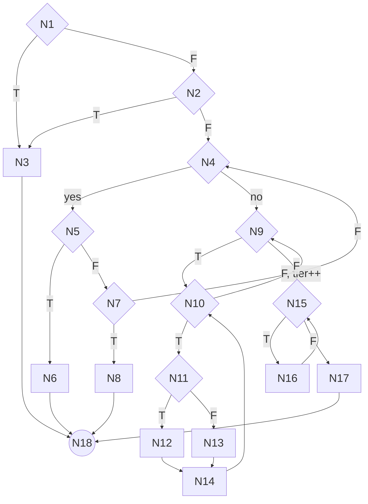
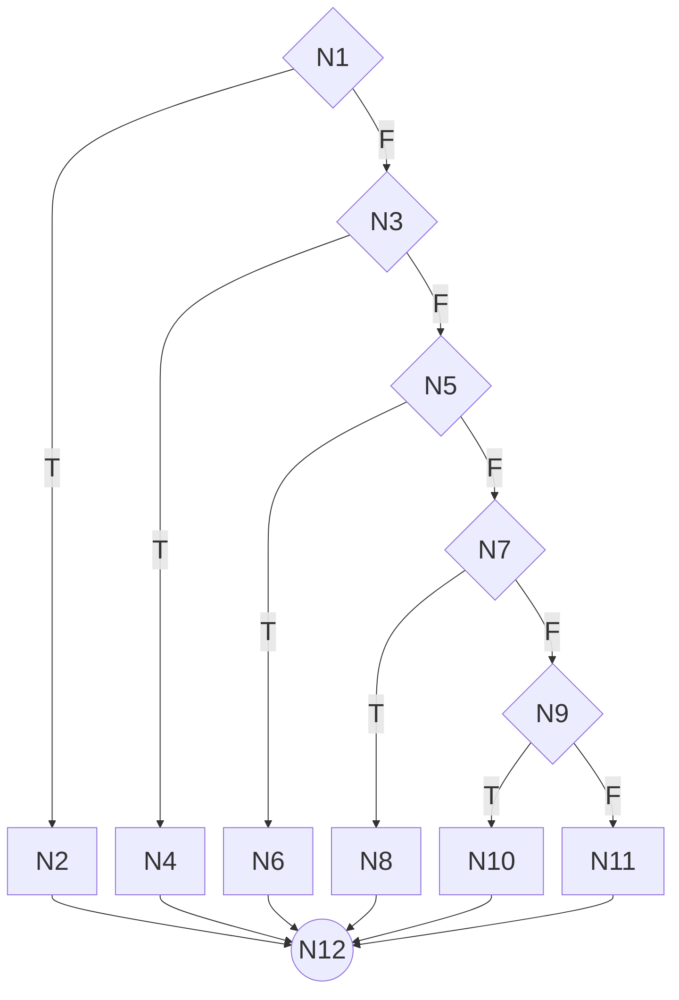
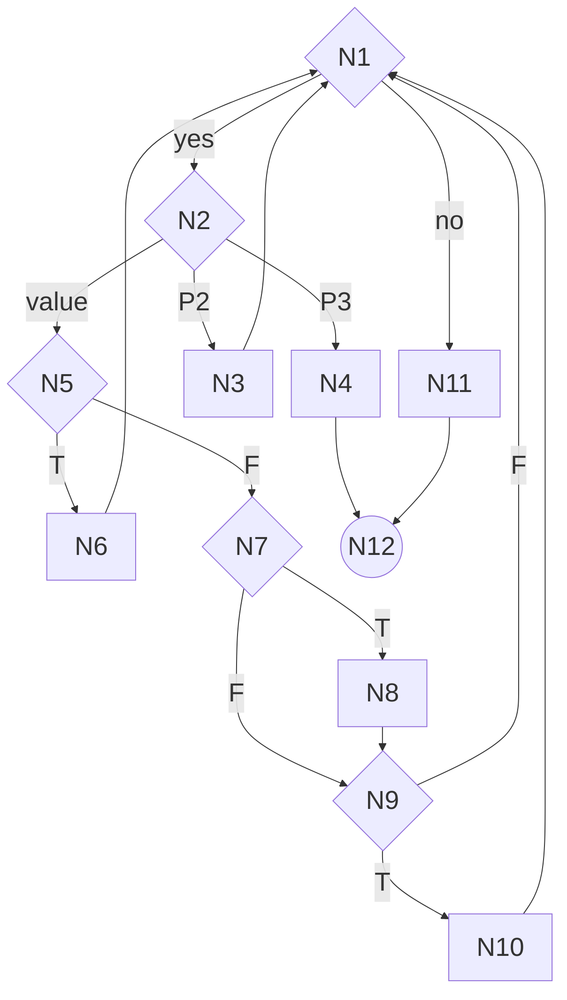

# MicroLend - White-Box Test Design (M2)

**Deliverable:** SE431 M2, "White-box test design" · **Document lead:** Muhammad Ibrahim (M2 Team Lead)
**Code baseline:** sections 2 to 5 drawn on `feature/ledger-entry` at `701c161` (14 Nov 2026: ledger queue L-01 to L-19 plus the two static-analysis fixes); sections 6 and 7 on `feature/delinquency-origination-import` at `7784a6a` (21 Nov 2026). All six methods were re-checked at code head `4067d2f` on 21 Nov: source, JaCoCo complexity and branch coverage unchanged.
**Tools:** CFGs drawn by hand from the source; complexity cross-checked with JaCoCo 0.8 (`build/reports/jacoco/test/jacocoTestReport.xml`, `COMPLEXITY` counter) and PMD 7.7.0 (`CyclomaticComplexity` rule).

## 1. Method

Compound conditions (`a || b`) are split into one decision node per simple condition, matching the bytecode branches JaCoCo counts. V(G) is computed as E - N + 2 and as P + 1, then cross-checked with JaCoCo.

### Selection of methods

These are the most complex methods on the money path. The four ledger methods are also the Fagan inspection target (`qa/inspections/INS-01-repayment-path/`); `DelinquencyClassifier.classify` is the basis-path target M1 named for `delinquency` (RTM FR-23).

| Method | Requirement | Why it is "key" |
|---|---|---|
| `RepaymentAllocator.allocate(Money, List<InstalmentDue>)` | FR-13, FR-14 (BR-18, BR-19, BR-20) | Decides where every rupee of every repayment goes; an error here corrupts penalties, ageing and provisioning downstream (risk R1) |
| `LoanAccount.restore(LoanId, LoanStatus, Money, LocalDate)` | FR-19 (BR-26) | Guards the status/closure-date invariant every repository load relies on |
| `LedgerEntry.requireValid(LoanId, EntryType, Money, Instant)` | FR-17 (BR-23, BR-24) | Gate for every ledger line; a zero or incomplete entry breaks the balanced-ledger invariant |
| `CoreRepaymentPoster.post(RepaymentCommand)` | FR-16, FR-19, QR-03 (BR-21, BR-23, BR-24, BR-26) | The one place a repayment changes both the ledger and the loan; its failure paths decide whether the ledger stays balanced (section 5) |
| `DelinquencyClassifier.classify(int)` | FR-23 (BR-30); feeds FR-24 (BR-31) and FR-27 (BR-34) | Puts every loan in a bucket each night. A wrong boundary misstates the provision and raises or misses classification alerts (section 6) |
| `EndOfDayEngine.collect(LocalDate, Map)` | FR-26, FR-27, FR-25 (BR-32, BR-33, BR-34); QR-06 | Turns the results of the concurrent tasks into the run's report: recorded, already recorded, failed, changed classification, due for write-off (section 7) |

The SE431 PDF prints the four methods with a drawn CFG (sections 2, 5, 6 and 7); the two guard-run methods, `LoanAccount.restore` and `LedgerEntry.requireValid` (sections 3 and 4, basis paths and V(G) in the table below), are in this file only.

### Complexity summary

| Method | P (simple decisions) | E | N | V(G) = E - N + 2 | JaCoCo | PMD 7.7.0 | Branch coverage (JaCoCo) |
|---|---|---|---|---|---|---|---|
| `RepaymentAllocator.allocate` | 9 | 26 | 18 | **10** | 10 | 13 | 18 / 18 |
| `LoanAccount.restore` | 7 | 20 | 14 | **8** | 8 | 13 | 14 / 14 |
| `LedgerEntry.requireValid` | 5 | 16 | 12 | **6** | 6 | 11 | 10 / 10 |
| `CoreRepaymentPoster.post` | 5 (4 are exception exits) | 16 | 12 | **6** | 2 | below threshold | 2 / 2 |
| `DelinquencyClassifier.classify` | 5 | 16 | 12 | **6** | 6 | below threshold | 10 / 10 |
| `EndOfDayEngine.collect` | 6 (2 are exception exits) | 17 | 12 | **7** | 5 | below threshold | 8 / 8 |

PMD's figure exceeds the graph value by each method's `throw` count (3, 5 and 5), consistent with PMD counting a `throw` as a decision; basis paths use the graph value. JaCoCo omits the exception exits of `post` and `collect` (section 5.1). M1 RTM estimates: allocator "CC about 11" (built: 10), `classify` "about 6" (built: 6).

---

## 2. `RepaymentAllocator.allocate`

Source: `src/main/java/pk/edu/giki/microlend/ledger/RepaymentAllocator.java`. Tier-by-tier reading of BR-18/BR-19, team decision D-01 (16 Nov 2026).

### 2.1 Nodes

| Node | Statement(s) | Decision |
|---|---|---|
| N1 | `if (payment == null` | P1 |
| N2 | second operand of the OR: `owing == null` | P2 |
| N3 | `throw` "a payment and a list ... are required" | |
| N4 | create `sequences`; `for (instalment : owing)`, has next? | P3 |
| N5 | `if (instalment == null)` | P4 |
| N6 | `throw` "... has a gap" | |
| N7 | `if (!sequences.add(instalment.sequence()))` | P5 |
| N8 | `throw` "instalment n appears twice" | |
| N9 | sort oldest first; create `applied`; `remaining = payment`; `tier < TIERS.size()`? | P6 |
| N10 | `i < oldestFirst.size()`? | P7 |
| N11 | `owed = tier(i)`; `remaining.compareTo(owed) < 0`? | P8 |
| N12 | `paid = remaining` (partial, BR-20) | |
| N13 | `paid = owed` (tier cleared) | |
| N14 | `applied[i][tier] = paid; remaining -= paid; i++` | |
| N15 | build `bySequence`, `total`; `i < oldestFirst.size()`? | P9 |
| N16 | add the instalment's `Allocation` and accumulate the total | |
| N17 | `return new AllocationResult(total, bySequence, remaining)` | |
| N18 | exit | |

### 2.2 CFG

E = 26, N = 18, so **V(G) = 26 - 18 + 2 = 10**, which equals P + 1 = 9 + 1.

### 2.3 Basis paths and test cases

Baseline BP-1: one instalment, paid exactly. Each later path flips one decision of a path already listed.

| Path | Route | Decision flipped | Test input (money in PKR) | Expected result | Closest automated test in `RepaymentAllocatorTest` |
|---|---|---|---|---|---|
| BP-1 | N1F N2F N4 N5F N7F N4 N9 N10 N11F N13 N14 ... N9F N15T N16 N15F N17 | baseline | 1 instalment (penalty 10.00, fees 0.00, interest 50.00, principal 200.00); payment 260.00 | each tier paid in full; unapplied 0.00 | `conservesThePayment`, `principalLast` |
| BP-2 | N1T N3 | P1 | payment `null`, 1 instalment | `InvalidAllocationException` | `Validation.rejectsMissingInput` |
| BP-3 | N1F N2T N3 | P2 | payment 100.00, list `null` | `InvalidAllocationException` | `rejectsMissingInput` |
| BP-4 | N1F N2F N4 N5T N6 | P4 | list `[null]` | `InvalidAllocationException` ("gap") | `rejectsMissingInput` |
| BP-5 | ... N7F N4 N5F N7T N8 | P5 | two instalments, both sequence 1 | `InvalidAllocationException` ("appears twice") | `rejectsDuplicateSequence` |
| BP-6 | N1F N2F N4(no) N9 N10F ... N9F N15F N17 | P3, P7 and P9 at zero iterations | payment 100.00, empty list | nothing allocated; unapplied 100.00 | `nothingOwed` |
| BP-7 | ... N11T N12 N14 ... | P8 | 1 instalment as BP-1; payment 30.00 | penalty 10.00, interest 20.00, principal 0.00; unapplied 0.00 | `partOfEachTier` |
| BP-8 | baseline with N10T and N15T taken twice per pass | P7, P9 (second iteration) | 2 instalments, due 10 Oct and 10 Nov (each penalty 5.00, interest 20.00, principal 100.00); payment 30.00 | both penalties 5.00 + 5.00 first, then 20.00 interest on the oldest; newest interest 0.00 | `twoOverdueTierByTier` |
| BP-9 | as BP-8, but the list is passed newest first | sort order feeding P7 | 3 instalments given out of due-date order | paid by due date, not by list position (BR-19) | `threeOverdueOutOfOrder` |
| BP-10 | N9F on first evaluation | P6 | none | **Infeasible.** `TIERS` is a constant list of 4 tiers, so the tier loop always runs 4 times | n/a (by inspection) |

The BVA cases (0.00, 0.01, due - 0.01, exactly due, due + 0.01) are TC-LED-01 and TC-LED-02 in `qa/test-design/black-box.md`, automated in the parameterised `boundaries` test and `oneRupeeShortOnNewestPrincipal`.

---

<!-- pdf:skip -->
## 3. `LoanAccount.restore`

Source: `src/main/java/pk/edu/giki/microlend/ledger/LoanAccount.java`.

| Node | Statement | Decision |
|---|---|---|
| N1 | `if (id == null)` | P1 |
| N2 | `if (status == null)` | P2 |
| N3 | `if (outstandingPrincipal == null)` | P3 |
| N4 | `if (status == ACTIVE` | P4 |
| N5 | `&& closedOn != null)` | P5 |
| N6 | `if (status != ACTIVE` | P6 |
| N7 | `&& closedOn == null)` | P7 |
| N8 to N12 | five `throw new InvalidLoanAccountException(...)` | |
| N13 | `return new LoanAccount(...)` | |
| N14 | exit | |

There are 7 decision nodes, 5 throw nodes, the return and the exit (N = 14). N4F and N5F lead to N6; N6F and N7F lead to N13; each throw node and N13 lead to the exit. Each decision has two out-edges (14) and each throw and the return one (6), so E = 20 and **V(G) = 20 - 14 + 2 = 8**, which equals P + 1 = 7 + 1.

| Path | Decisions | Input | Expected | Automated in `LoanAccountTest` |
|---|---|---|---|---|
| BP-1 | P1..P3 F, P4 T, P5 F, P6 F | ACTIVE, closedOn null | account created, `isClosed()` false | `activeAccountState`, `activeLoanAcceptsPayment` |
| BP-2 | P1 T | id null | `InvalidLoanAccountException` | `rejectsNullFields` |
| BP-3 | P2 T | status null | `InvalidLoanAccountException` | `rejectsNullFields` |
| BP-4 | P3 T | principal null | `InvalidLoanAccountException` | `rejectsNullFields` |
| BP-5 | P4 T, P5 T | ACTIVE with closedOn 2026-11-01 | `InvalidLoanAccountException` | `activeAccountHasNoClosureDate` |
| BP-6 | P4 F, P6 T, P7 T | CLOSED, closedOn null | `InvalidLoanAccountException` | `closedAccountNeedsClosureDate` |
| BP-7 | P4 F, P6 T, P7 F | CLOSED, closedOn 2026-11-01 | account created, `isClosed()` true | `restoredClosedAccountState`, `closedLoanRejectsPayment` |
| BP-8 | P4 F, P6 T, P7 F, status WRITTEN_OFF | WRITTEN_OFF, closedOn 2026-11-01 | account created; payment then rejected (BR-26) | `writtenOffLoanRejectsPayment` |

JaCoCo reports 14 of 14 branches covered.

---

## 4. `LedgerEntry.requireValid`

Source: `src/main/java/pk/edu/giki/microlend/ledger/LedgerEntry.java`. Five sequential guards (loan id, type, amount, posting time, zero amount) each lead to a throw. E = 16, N = 12, so **V(G) = 16 - 12 + 2 = 6**, which equals P + 1 = 5 + 1.

| Path | Flipped guard | Input | Expected | Automated in `LedgerEntryTest` |
|---|---|---|---|---|
| BP-1 | none | valid debit of 100.00 | entry created, credit column 0.00 | `debitEntry`, `creditEntry` |
| BP-2 | loanId null | | `InvalidLedgerEntryException` | `rejectsNullFields` |
| BP-3 | type null | | `InvalidLedgerEntryException` | `rejectsNullFields` |
| BP-4 | amount null | | `InvalidLedgerEntryException` | `rejectsNullFields` |
| BP-5 | postedAt null | | `InvalidLedgerEntryException` | `rejectsNullFields` |
| BP-6 | amount 0.00 | | `InvalidLedgerEntryException` ("must move money") | `rejectsZeroAmount` |

JaCoCo: 10 of 10 branches covered; the class as a whole 37 of 44 (gaps in `equals` and `reversalOf`, section 8).

---

<!-- /pdf:skip -->

## 5. `CoreRepaymentPoster.post`

Source: `src/main/java/pk/edu/giki/microlend/ledger/CoreRepaymentPoster.java`, the concrete component the Decorator chain wraps (M1 section 5.3).

### 5.1 Why exception edges are drawn as decisions

JaCoCo gives `post` complexity **2**: it counts only bytecode branches, and `post` has one `if` (payment above the payoff). Its other exits are collaborator exceptions (`orElseThrow` for an unknown loan, `ensureAcceptsPayment` for a closed loan, a failing `appendAll`, a failing `save` with its compensating reversal). BR-26 and QR-03 require those exits, so the CFG draws each as a decision node.

| Node | Statement | Decision |
|---|---|---|
| N1 | `loans.findById(loanId)` found? | P1 |
| N2 | `throw LoanNotFoundException` | |
| N3 | `account.ensureAcceptsPayment()` passes? (BR-26) | P2 |
| N4 | `throw LoanClosedException` | |
| N5 | allocate, settle; `!outcome.excess().isZero()`? | P3 |
| N6 | `throw InvalidRepaymentException` (excess over payoff) | |
| N7 | build lines; `requireBalanced`; `ledger.appendAll(lines)` succeeds? | P4 |
| N8 | exception propagates; nothing written, loan not saved | |
| N9 | `loans.save(outcome.account())` succeeds? | P5 |
| N10 | `reverse(lines, saveFailed)`; rethrow | |
| N11 | `return new PostingResult(...)` | |
| N12 | exit | |

The 5 decision nodes have 2 out-edges each (10); N2, N4, N6, N8, N10 and N11 have 1 each to the exit (6). E = 16, N = 12, so **V(G) = 16 - 12 + 2 = 6**, which equals P + 1 = 5 + 1.

### 5.2 Basis paths

| Path | Decisions | Input | Expected | Automated test |
|---|---|---|---|---|
| BP-1 | P1 found, P2 pass, P3 no excess, P4 ok, P5 ok | active loan, partial payment | 1 `PAYMENT_RECEIVED` debit balanced by the tier credits; loan saved with reduced principal | `CoreRepaymentPosterTest.partialPaymentLines`, `principalReducesAccount`, `ledgerBalancesAfterEveryPosting` |
| BP-2 | P1 not found | unknown loan id | `LoanNotFoundException`; nothing written | `unknownLoan` |
| BP-3 | P2 closed | CLOSED or WRITTEN_OFF loan | `LoanClosedException`; nothing written | `closedLoanRefused` |
| BP-4 | P3 excess | payoff amount + 0.01 | `InvalidRepaymentException`; nothing written | `excessOverPayoffIsRefused` |
| BP-5 | P4 append fails | ledger writer that throws | exception propagates; loan not saved | `failedWriteDoesNotSaveLoan` |
| BP-6 | P5 save fails | loan repository that throws on save | every posted line reversed (BR-24), then the failure is rethrown; the ledger nets to zero | `PostingFaultInjectionTest.failureLeavesLedgerBalancedWithNoOrphans` (loan-save failure points) |

Variants of BP-1 cover BR-21 (`surplusBecomesAdvanceCredit`) and the BR-22 payoff (`exactPayoffClosesLoan`): same path, different data, so boundary cases rather than basis paths.

### 5.3 `requireBalanced` (BR-23)

One loop and one `if` give V(G) = 3; JaCoCo agrees (4 of 4 branches). Paths: empty list (loop skipped, balanced), balanced lines, unbalanced lines. `post` always builds balanced lines, so only `imbalanceDetected`, calling the package-private method directly, reaches the unbalanced path. The method is a guard against a future change to `linesFor`, not dead code.

---

## 6. `DelinquencyClassifier.classify`

Source: `src/main/java/pk/edu/giki/microlend/delinquency/DelinquencyClassifier.java`. BR-30 buckets: 0 Standard, 1-30 Watch, 31-60 Substandard, 61-90 Doubtful, 91 or more Loss, with upper limits `WATCH_MAX = 30`, `SUBSTANDARD_MAX = 60` and `DOUBTFUL_MAX = 90`.

### 6.1 Nodes

| Node | Statement | Decision |
|---|---|---|
| N1 | `if (daysPastDue < 0)` | P1 |
| N2 | `throw new InvalidDaysPastDueException(daysPastDue)` | |
| N3 | `if (daysPastDue == 0)` | P2 |
| N4 | `return Classification.STANDARD` | |
| N5 | `if (daysPastDue <= WATCH_MAX)` | P3 |
| N6 | `return Classification.WATCH` | |
| N7 | `if (daysPastDue <= SUBSTANDARD_MAX)` | P4 |
| N8 | `return Classification.SUBSTANDARD` | |
| N9 | `if (daysPastDue <= DOUBTFUL_MAX)` | P5 |
| N10 | `return Classification.DOUBTFUL` | |
| N11 | `return Classification.LOSS` | |
| N12 | exit | |

### 6.2 CFG

### 6.3 Cyclomatic complexity, computed two ways

- **From the graph:** the 5 decision nodes have 2 out-edges each (10); N2, N4, N6, N8, N10 and N11 have 1 each to the exit (6). E = 16, N = 12, so **V(G) = 16 - 12 + 2 = 6**.
- **From the decisions:** P = 5 simple decisions (P1 to P5, none compound), so **V(G) = P + 1 = 6**.

JaCoCo agrees (6; 10 of 10 branches). PMD 7.7.0 does not report it (below its threshold of 10).

### 6.4 Basis paths and test cases

Baseline: every decision false (a Loss loan). Each other path flips one baseline decision, so the six are linearly independent and cover all 10 branches.

| Path | Route | Decision flipped | Test input (days past due) | Expected result | Automated in `DelinquencyClassifierTest` |
|---|---|---|---|---|---|
| BP-1 | N1F N3F N5F N7F N9F N11 | baseline | 91 (also 400) | `LOSS` | `bucketBoundaries` rows `91, LOSS` and `400, LOSS` |
| BP-2 | N1T N2 | P1 | -1 | `InvalidDaysPastDueException` | `negativeRejected` (TC-DEL-03.1) |
| BP-3 | N1F N3T N4 | P2 | 0 | `STANDARD` | `bucketBoundaries` row `0, STANDARD` |
| BP-4 | N1F N3F N5T N6 | P3 | 1 (also 30) | `WATCH` | `bucketBoundaries` rows `1, WATCH` and `30, WATCH` |
| BP-5 | N1F N3F N5F N7T N8 | P4 | 31 (also 60) | `SUBSTANDARD` | `bucketBoundaries` rows `31, SUBSTANDARD` and `60, SUBSTANDARD` |
| BP-6 | N1F N3F N5F N7F N9T N10 | P5 | 61 (also 90) | `DOUBTFUL` | `bucketBoundaries` rows `61, DOUBTFUL` and `90, DOUBTFUL` |

No path is infeasible. The second inputs on BP-1 and BP-4 to BP-6 (other edge of each bucket) are TC-DEL-03 BVA cases (`qa/test-design/black-box.md` section 6.3), not basis paths. The class has 10 test invocations: `negativeRejected` and the 9 rows of `bucketBoundaries`.

---

## 7. `EndOfDayEngine.collect`

Source: `src/main/java/pk/edu/giki/microlend/delinquency/EndOfDayEngine.java`. `run` submits one task per active loan to the four-thread pool; `collect` waits for each `Future` in loan order and builds the `EodReport`. As in section 5, the two `Future.get()` failures are decisions, because BR-33 and M1 section 3.6 require that a failing loan is reported without stopping the others and that an interrupted run stops cleanly.

### 7.1 Nodes

| Node | Statement | Decision |
|---|---|---|
| N1 | counters and lists created; `for (task : tasks.entrySet())`, has next? | P1 |
| N2 | `result = task.getValue().get()`: returns / `ExecutionException` / `InterruptedException` | P2, P3 (three-way) |
| N3 | `failures.put(loan, cause)`; `continue` | |
| N4 | re-interrupt the thread; `throw IllegalStateException` | |
| N5 | `if (!result.recorded())` | P4 |
| N6 | `alreadyRecorded++`; `continue` | |
| N7 | `recorded++`; add the penalty; `if (result.change() != null)` | P5 |
| N8 | `changes.add(result.change())` | |
| N9 | `if (result.writeOffDue())` | P6 |
| N10 | `writeOffs.add(loan)` | |
| N11 | `return new EodReport(...)` | |
| N12 | exit | |

### 7.2 CFG

Edge labels at N2: "value" when `get()` returns, P2 for `ExecutionException`, P3 for `InterruptedException`.

### 7.3 Cyclomatic complexity, computed two ways

- **From the graph:** N1, N5, N7 and N9 have 2 out-edges each (8), N2 has 3, and N3, N4, N6, N8, N10 and N11 have 1 each (6). E = 17, N = 12, so **V(G) = 17 - 12 + 2 = 7**.
- **From the decisions:** the loop test, three `if`s and the three-way node (2 simple decisions) give P = 6, so **V(G) = P + 1 = 7**.

JaCoCo reports 5, with 8 of 8 branches covered: it leaves out P2 and P3, since a caught exception is not a bytecode branch (7 - 2 = 5).

### 7.4 Basis paths and test cases

Baseline: one loan, recorded, no classification change, no write-off.

| Path | Decisions | Input | Expected | Automated in `EndOfDayEngineTest` |
|---|---|---|---|---|
| BP-1 | P1 yes, P2/P3 result, P4 F, P5 F, P6 F, then P1 no | first run for a date; no earlier snapshot; 10 days overdue | counted as recorded; no event; no write-off | `processesEveryLoan` (20 loans), `nothingOverdue` |
| BP-2 | P1 no on the first test | no active loans | empty report: 0 recorded, no failures | **Not automated** (gap below) |
| BP-3 | P2: `ExecutionException` | the instalment source throws for LN-3 | LN-3 listed in `failures`; the other 9 loans recorded | `failingTaskDoesNotBlockThePool` |
| BP-4 | P3: `InterruptedException` | the thread calling `run` is interrupted while it waits | interrupt flag restored; `IllegalStateException` naming the business date | **Not automated** (gap below) |
| BP-5 | P4 T | second run for the same date, or a run for an earlier date after a later one | counted as already recorded; nothing written (BR-33) | `idempotentPerBusinessDate`, `earlierDateAfterALaterRunIsSkipped` |
| BP-6 | P5 T | yesterday Watch, today 31 days (Substandard); and Substandard to Watch | one `ClassificationChangeEvent` each; none for Watch to Watch (BR-34) | `classificationChangeEvents` |
| BP-7 | P6 T | 181 days past due | loan listed in `writeOffsDue` (BR-32) | `writeOffDueIsReported` |

`ConcurrentTellerAndEndOfDayTest.tellersAndEndOfDayTogether` runs BP-1 for 5 loans on SQLite while four teller threads post to the same loans.

---

## 8. Coverage baseline and gaps (M2)

`./gradlew clean build jacocoTestReport` on the 22 Nov build (`develop` at `e7ecce6`, with `products` and `reporting`): 492 tests in 69 test classes, 0 failures, 0 skipped. Report-level counters of `jacocoTestReport.xml`:

| Counter | Covered / total | % |
|---|---|---|
| Lines | 1,680 / 1,761 | 95.4 |
| Branches | 563 / 642 | 87.7 |
| Methods | 390 / 394 | 99.0 |

By package (lines; branches):

| Package | Lines | Branches |
|---|---|---|
| `origination` | 159 / 159 | 84 / 90 |
| `delinquency` | 148 / 152 | 52 / 54 |
| `ledger` | 440 / 451 | 155 / 178 |
| `ledger.importing` | 99 / 102 | 30 / 32 |
| `common` | 67 / 69 | 24 / 26 |
| `products` | 211 / 221 | 90 / 110 |
| `reporting` | 65 / 65 | 16 / 16 |
| `persistence` | 308 / 338 | 78 / 92 |
| `web` | 129 / 132 | 27 / 32 |
| root (`CompositionRoot`, `MicroLendApplication`, the two `products` adapters) | 54 / 72 | 7 / 12 |

Earlier baselines: `4067d2f` (21 Nov), 384 tests, 1,309 / 1,375 lines (95.2%), 437 / 492 branches (88.8%), 294 / 298 methods (98.7%); `7784a6a` (21 Nov), 366 tests, 1,266 / 1,331 lines (95.1%), 422 / 474 branches (89.0%), 286 / 290 methods (98.6%); `701c161`, 182 tests, 773 / 818 lines (94.5%), 244 / 282 branches (86.5%), 184 / 188 methods (97.9%), for `common`, `ledger`, `persistence` and `web` only. The 60% target applies to core business logic at M3.

Open gaps (they feed `qa/defect-log.md` only if a test reveals a fault):
- `LedgerEntry`: 7 unexecuted branches in `equals` and the null and blank checks of `reversalOf`.
- `EndOfDayEngine.collect`: BP-2 and BP-4 have no test; BP-4's 3 lines are 3 of the 4 uncovered lines in `delinquency`. The fourth is the `EndOfDayEngine.process` branch where `record` reports that another writer stored the same loan and date between the engine's check and write.
- `MicroLendApplication.main` (15 lines, 4 branches): no test; exercised by hand with `./gradlew run`.
- `persistence`: most of the 30 uncovered lines are `catch (SQLException)` blocks translating storage failures into `PersistenceException`, plus `SqliteDatabase.closeQuietly`.
- `products` and `reporting` arrived after this selection was made; `LoanProduct.generateSchedule` and `ScheduleAssembler.assemble` get white-box designs at M3.
